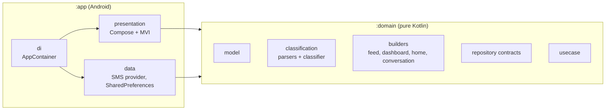
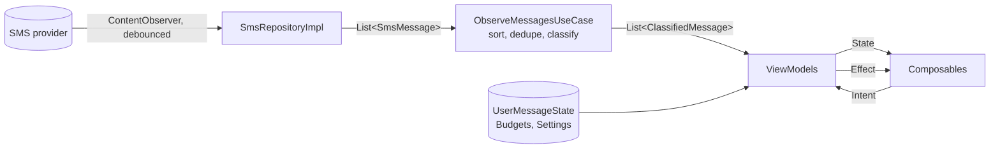

# Architecture

Two Gradle modules with a strict dependency direction.

`:domain` has no Android dependency, so the compiler enforces the rule and its tests run on any JVM.

## Data flow

## Presentation (MVI)

Each screen has a `Contract` (immutable `State`, `Intent`, one-shot `Effect`) and a `ViewModel` that reduces
intents into state. Composables are stateless (`State` in, `(Intent) -> Unit` out); the `*Route` composable
connects the ViewModel and handles effects (clipboard, links, permission).

Derived data (the feed, the dashboard, the home overview, conversations) is built by pure functions in
`:domain` (`FeedBuilder`, `DashboardBuilder`, ...) and stored in `State`, so recomposition does no heavy work.

## Classification

`MessageClassifier` runs rules in order (OTP, FASTag, money, data usage, courier, loyalty, generic). Money
messages go to the hand-written bank parsers first and then to `GenericTransactionParser`, a best-effort reader
for other banks' wording. It never throws and parses at most 4096 characters.

## Sheets and pages

Rule: **big content = a page, small content = a sheet.** A page is an `AppPage` (title, back arrow, content that scrolls,
optional pinned `footer`) drawn by `PageHost` over the screens and slid in from the side, like "Your year". A sheet is
`AppBottomSheet`, drawn by `SheetHost` over the pages, so a picker opened from a page appears above it, and the snackbar
(`LocalAppSnackbar`) is drawn above both. Compact pickers and confirmations (up to about five fields, simple choices)
stay sheets; long forms, detail views with many sections, lists of more than about eight rows, charts with lists and
multi-step flows are pages.

`AdaptiveSheet(title, onDismiss, asPage = false, autoPage = true, subtitle, footer, contentSpacing) { content }`
(`presentation/common/AdaptiveSheet.kt`) applies the rule in one place. `asPage = true` is a page from the first frame
(for content known to be large). Otherwise the sheet is first laid out invisibly (`AppBottomSheet(ready = false)`); if
header, content and footer together are taller than 85% of the window, the same content is shown as a page and the
sheet is never seen. The decision is made once and kept over rotation. State kept by the caller survives the switch; state
remembered inside the content lambda restarts. `FormSheet` is built on it (`asPage` too), so every form adapts. Content
that scrolls by itself (a lazy list or web view) uses `AppPage(scrollable = false)`. `SheetPolicyTest` keeps bare
`AppBottomSheet` to the compact allow-list and forbids fixed sheet heights.

## Flights on the day you fly

A flight booked by SMS gets a card at the top of Home on the day of travel, and a bottom sheet with its full status.

- **Domain (`domain/flight`, pure, tested).** `FlightParser` reads one airline text (IndiGo `6E`, Air India `AI`, Vistara `UK`,
  SpiceJet `SG`, Akasa `QP`, Air India Express `IX`, and others in `Airlines`) into `FlightFacts`: airline, number, the day of
  travel (never the day it was booked), route (codes or city names), scheduled times, PNR, terminal, gate and what the text is
  (booking, reminder, check-in, boarding, delay, gate change, cancellation). `FlightTracker.bookings` merges every text about
  one flight (airline + number + day), oldest first, so a later delay or cancellation wins; a text with no date joins the flight
  nearest the day it arrived. `FlightTracker.today` decides which flights show: from the start of the departure day on the
  *departure airport's* clock until three hours after landing (overnight flights stay until they land; a flight with no times
  stays all day; a cancelled one too). `snapshot` merges the booking with live data into one `FlightSnapshot`, and `FlightText`
  holds every phrase ("Departs 14:35 · in 2h 10m", "Delayed 25 min · new 15:00"), so the wording is tested.
- **Live data.** `FlightStatusParser` reads Flightradar24's flight-history reply (`result.response.data[]`) and picks the leg
  whose scheduled departure falls on the booked day. **It was written from the known shape of that unofficial endpoint and has not
  been run against the live service** (the build environment's proxy blocks the host); a captured reply should replace the
  fixture in `FlightFixtures`. Anything unexpected is `Unreadable` and the app keeps the last known status.
- **Network (`data/markets/FlightFetcher`).** The third pinned network class: one host, 5 s timeouts, 512 KB cap, no redirects,
  no cookies, a generic User-Agent, status codes only in the log. `ManifestPolicyTest` pins the host and the file list.
- **Service (`data/flights/FlightService`).** In-memory statuses by flight key; an answer under 25 s old is reused, so the
  Home refresh (once each time Home is STARTED), the sheet's 30 s timer and the in-flight service never double up; at most three
  flights. Off until `flight_status.live_enabled` is true. It owns the only `FlightFetcher`; `lookup` (the "Look up flight" step of
  the add-a-flight form) goes through it too and is answered with nothing in the demo.
- **Flights added by hand (`domain/flight/ManualFlights`, `data/repository/ManualFlightRepositoryImpl`).** `ManualFlight` (airline,
  number, day, optional PNR note, and the route and times when a look-up confirmed them) lives in `ManualFlightStore` (atomic,
  tested; `NoManualFlights` for tests) behind `ManualFlightRepository`, persisted in the private `manual_flights` preferences,
  which go into the setup backup. `ManualFlights.merge` joins them to the flights found in texts by airline + number + day (the
  text version wins, the hand-made one fills what it lacks, so the same flight is never twice); `isExpired` drops one a day after it
  should have landed. `ManualFlightRules` validates the form. The form (`ManualFlightUi`, a `FormSheet`) is reached from the Home
  flight card, the entry sheet ("Adding a flight instead?") and Settings > Live flight status, which also lists them with Edit and
  Remove (Undo in a snackbar). In the demo the preferences are the demo's in-memory ones.
- **The in-flight notification (`notifications/FlightTrackingService`, `FlightTrackingControl`, `FlightNotifier`; domain `FlightTracking`,
  `FlightNotificationText`).** While a tracked flight is in the air, or about to leave, a foreground service of type `dataSync`
  keeps one ongoing notification up to date every 30 s (title "In the air · DEL → MAA", or "Departs in 25 min", "Boarding",
  "Delayed 12 min" before it leaves; line "Lands 16:40 · 12 min late"; a progress bar; a system countdown to landing; "Updated 14:32:10";
  one action "Stop tracking"). It asks only through `FlightService.refresh`,
  so the pinned host, timeouts and caps are the same as everywhere. `FlightTracking` (pure, tested) decides everything: a flight is
  WAITING, DEPARTING (within 30 min of its best departure), IN_AIR (live says departed or in the air; with no live data at all, the
  booked times say so), or over (LANDED, also worked out when the arrival time has passed and a later answer no longer says it is
  flying; CANCELLED; DIVERTED; GAVE_UP 30 min after the planned landing); at most two flights at once, each with its own stable
  notification id. When one ends the ongoing notification is replaced, under the same id, by a dismissible one ("Landed · DEL → MAA
  at 16:34", "6 min early · Terminal 1 · Belt 4"; or cancelled, diverted, "Tracking ended"). The service ends by itself on those, on
  live status or the tracking switch being turned off, on notifications being revoked, on "Stop tracking" (remembered per flight in
  the `flight_plan` preferences, which are not backed up), and on the system's time limit (Android 15 allows a data-sync service
  about six hours a day: `onTimeout`, or a self-imposed 5 h 50 min, leaves a dismissible "Tracking paused · Open Zyke to resume").
  After more than 10 failed answers in a row it says "Can't refresh · last update HH:MM" and asks only every five minutes until one
  works; the notification stays until the 30-minute cut-off. It is not sticky.
  **How it starts, honestly.** (1) When Home is showing and a flight is in the air or leaves within 30 min: an activity in front may
  start a foreground service on every Android version. This is the reliable path. (2) One alarm for the next flight, 10 minutes
  before departure (`FlightAlarmReceiver`; re-set after a restart by `BootReceiver`, and whenever flights or switches change;
  never in the demo). The app asks for no exact-alarm permission (nothing in the app uses one; `USE_EXACT_ALARM` is for alarm and
  calendar apps), so the alarm is inexact and Android may move it by minutes, or more while the phone dozes. Before Android 12 the alarm starts the
  service itself. From Android 12 a foreground service cannot be started from the background, so the alarm leaves a high-priority
  "Tap to start live tracking" notification and tapping it opens the app, which starts the service from the foreground. With live
  status off the alarm leaves one ordinary dismissible reminder and nothing ongoing. The service is never started from the boot
  broadcast (Android 15 forbids that for data-sync). So with the app closed on Android 12+, tracking begins when the person taps
  that notification or opens the app, not on its own. Not verified on a device.
  **Lock screen, always-on display and Android 16 Live Updates.** The ongoing and the finished notification are `VISIBILITY_PUBLIC`
  with the real text by default (a flight is not an amount; "Hide amounts" still masks any money in the words); Settings > Live
  flight status > "Show flight details on the lock screen" (stored in `flight_status`, default on) switches back to `VISIBILITY_PRIVATE`
  with the redacted "Flight in progress" public version. The channel is a new id (`flight_live`; the first `flight_tracking`, LOW
  importance with private lock-screen content, is deleted, because an app cannot change a channel's settings afterwards):
  `IMPORTANCE_DEFAULT` with no sound, vibration or lights, and no override of the lock-screen visibility. DEFAULT rather than LOW so
  it sits with the alerting notifications on the lock screen (Android 12+ lets people show only those there); with no sound and
  `setOnlyAlertOnce` it never makes a noise, and only HIGH importance pops up, which it is not. The notice is `CATEGORY_PROGRESS`,
  ongoing, with a `setWhen` + chronometer count-down to landing (before departure: to departure) so the system moves the clock between
  the 30 s updates, and the domain gives a chip text ("1h 05m", at most 7 characters) and the bar's take-off and landing points
  (`FlightNotificationText.chip`, `countdownTarget`, `PROGRESS_POINTS`, tested). There is no custom `RemoteViews`: the standard
  layout keeps the system's own theming, dark mode and AOD dimming, and a custom view would stop it from being a Live Update. It is not
  colourised (a colourised notification cannot be promoted).
  On Android 16 (API 36) `LiveUpdates.promote` rebuilds the notification with `Notification.ProgressStyle` (a bar with a plane, the
  take-off and landing points), `setShortCriticalText` (the chip) and `setRequestPromotedOngoing(true)`, with the new normal
  permission `POST_PROMOTED_NOTIFICATIONS`. **compileSdk stays 35**: the repo's Android Gradle Plugin is 8.8.0 (API 36 needs 8.9.1+),
  CI installs only `platforms;android-35`, and androidx.core 1.15 has no wrapper, so those few calls are made by reflection in that one
  file, inside a `try`/`catch (Throwable)` that returns the ordinary notification on any failure (and does nothing before Android 16).
  Moving to compileSdk 36 means AGP 8.9.1+ and `platforms;android-36` in `build.yml`, then the reflection can become plain calls.
  When the flight ends the service posts the finished notice as an ordinary notification under the same id, which is how a Live
  Update ends. Settings reads `NotificationManager.canPostPromotedNotifications()` and, if the person has turned Live updates off for
  the app, says so with a button to that system page; it also reads the phone's `lock_screen_allow_private_notifications` /
  `lock_screen_show_notifications` (read-only, no permission) and, if they hide content, says the flight may show as "Sensitive content
  hidden" with a button to the system security settings. With the switch off the notice is never asked to be promoted.
  **What is and is not known.** Before Android 16 this is an ongoing, public notification on a default-importance silent channel: it is
  on the lock screen when the phone shows notifications there. Whether it appears on the always-on display is the phone maker's and the
  person's choice (Pixel's "Always show time and info", Samsung's AOD notification icons, Xiaomi's and others' own rules differ, and many
  show only an icon or nothing for a third-party app); the app does nothing special for it and cannot force it. On Android 16 the
  system decides which promoted notifications get the chip, the lock-screen card and the AOD treatment; the app only asks. None of
  this has been run on a device.
- **UI (`presentation/flights`).** `FlightCard` (at most two rows, then "n more flights"; dismissible for the day through the
  dismissed-keys list) and `FlightSheet` (`AdaptiveSheet`, `autoPage = false`; route header with a Canvas progress line, times,
  terminal/gate/belt, PNR with Copy; refreshes every 30 s only while it is on screen and the app is STARTED; failed, not-found,
  off and demo states each have their own line). Nothing animates in a loop; the text clock ticks per minute (card) or second
  (open sheet) only while the screen shows.
- **Demo.** `DemoData` adds a booking for a flight about two hours ahead; `DemoFlights.live` makes up its status from the clock
  (25 minutes late, then in the air, then landed). `FlightService` answers the demo before the fetcher is reachable
  (`DemoPolicyTest`): no alarm, no service, no notification and no look-up reaches the network there.

## Trains on the day you travel

Indian Railways journeys booked by SMS (IRCTC, Railways, RailYatri, ixigo and the like) get the same treatment as flights, as a
parallel set of classes rather than a shared "trip" type, so nothing about flights changed: `domain/train` beside `domain/flight`,
`presentation/trains` beside `presentation/flights`, the same shape in `data` and `notifications`. What is shared is shared on
purpose: `Place`, `FlightEndpoint`/`TimeShift` (the route strip), `FlightNotice` (the words of a notification), `Countdown`, the
`FlightText` clock phrases, `StopReason`, the flight timings (`TrainTracking` takes its constants from `FlightTracking`), the
lock-screen switch, `LiveUpdates.promote` (with a train icon) and `FlightTrackingControl.canNotify`.

- **Domain (`domain/train`, pure, tested).** `TrainParser` reads one railway text into `TrainFacts`: the five-digit train number
  and name, day of journey (never the booking day), boarding and destination stations (codes like `MS`/`NDLS`, or names, from the
  short `Stations` table; unknown codes still show), scheduled departure and arrival, class (SL, 3A, 2A, 1A, CC, 2S...), coach and
  berth (`S4 32 SU`), RAC/WL/CNF, the 10-digit PNR (shown and copyable, never sent) and what the text is (booking, chart prepared,
  platform, delay, reschedule, train cancelled, partly cancelled, the person's own ticket cancelled). `TrainTracker.bookings` merges
  every text about one journey (train number + day), oldest first; a text with no date joins the nearest journey. `today` shows a
  journey from the start of its day (six hours before one that leaves in the small hours) until three hours after arrival; a cancelled
  ticket never shows. `snapshot` merges the booking with live data **from the person's boarding station**: the delay at *their*
  station until the train has left it ("Reaches your station in 1h 5m"), then where the train is, the next stations with expected
  times, and the journey from boarding to destination, with "+1"/"+2" for arrival days later. All times are on the Indian clock.
  `TrainText`, `TrainCardModel` and `TrainNotificationText` hold every phrase (early, on time, late, "1 h 5 min", overnight,
  multi-day, boarding mid-route).
- **Live data, honestly.** The source is **Live Train Status, Indian Rail API** (`indianrailapi.com`), a documented service that takes a
  personal key. `IndianRailApiParser` reads its reply as the provider's documentation page shows it (`ResponseCode` "200",
  `StartDate` dd-MM-yyyy, `CurrentStation`, `TrainRoute` with 12-hour "04:27PM" times, "Source"/"Destination" at the ends, delays like
  "14 M"); `TrainFixtures.documentationSample` is that page's example, verbatim (dated 2018), and the other fixtures are hand-built in
  the same shape. **The address, HTTPS support, the reply format today, the response codes other than "200" and the free-tier limits are
  unverified**: the build environment cannot reach the host. The first source tried (an unofficial one) never worked on a real phone
  (404 on every path) and was removed together with the developer probe that looked for alternatives. Because the times carry no date,
  the day of each stop comes from the order of the schedule (a time earlier than the one before it is after midnight; a departure
  earlier than its arrival too; the `Day` field only moves a stop later, as the sample says "0" for every stop); reported times take the
  day nearest their scheduled time. The current station may be missing from the route list (the sample's is): it is placed by its
  schedule. Stops up to the current one carry **actual** times, the stops ahead the provider's times as **expected** ones. The delay is
  the current station's (departure delay once it has left, else arrival), else worked out from the times, else left at 0. The reply
  has no cancelled, diverted or platform information, so those are never set. A response code other than "200" is not a status: the
  provider's `Message` is matched by keywords to "limit reached", "key rejected" or "no data" (guesses, tested), anything else is
  "unavailable" (`TrainLookup.Refused`/`NotFound`). Anything unreadable is `Unreadable`. The card then says in one line what happened
  (`LiveCheck.cardLine`: "Train data key was rejected" for HTTP 401/403, "Daily limit reached" for 429, "Live status unavailable right
  now" for other codes, "Couldn't make a secure connection", "No running status for this train on this day", else "Couldn't refresh")
  and keeps the booking and schedule. The person's boarding station can be on a later day of the run than the day they travel; the first
  reply tells which run day it is on and `TrainService` asks again once with the right start date.
- **The key (`TrainKeyStore`, `TrainSettings`, `TrainKeySection`).** Settings > Flights and trains > Live train status has the "Train data
  key" field (one masked line with Show/Hide, Done, validated by `TrainApi.keyProblem`: not empty, no spaces, at most 100 characters,
  nothing that would change the address), Save and Clear. It is stored the way the UAN is: in the device-only preference file
  `train_key_device` (nothing else in it), and the day's request count in `train_usage_device` (a day and a number, never the key); both
  are in `PrefsBackup`'s exclusion list, `backup_rules.xml` and `data_extraction_rules.xml` leave every preference file out, and
  "Delete all my data" removes them. The typed text lives in `remember` (not saved instance state). Nothing logs the key or puts it in an
  exception or notification; `TrainApi.redact` removes it (and anything after `apikey/`) from the text the developer tools share. Live
  status cannot be switched on without a key (`TrainSettings.liveEnabled` is the switch AND a saved key, and everything that asks reads
  it), and clearing the key switches it off. The Demo has no key and no network.
- **Network (`data/markets/TrainFetcher`).** The fourth pinned network class: one host (`indianrailapi.com`), HTTPS only (the
  documentation shows plain http; the key is not sent in clear text and there is no fallback), 5 s timeouts, 512 KB cap, no redirects, no
  cookies, a generic User-Agent, status codes only in the log. It sends the train number, the run's start date (yyyymmdd; the run's
  start day, so for a station reached on a later day the journey day less the boarding day) and the key, in the address, nothing else.
  `ManifestPolicyTest`, `LegalPolicyTest` and `LegalText` pin the host.
- **Quota care.** Every request that goes out (a timed-out one is tried once more, and counts twice) increments the day's count, shown in
  the page as "Live train requests today: N" with "Your plan may limit requests"; no limit of the provider is claimed because none is
  known. Asking happens only while the app shows the trip (Home coming to the front, the open train sheet every 30 seconds) or while the
  notification is active (`TrainTrackingService`); answers under 25 s old are reused, so the three never double up; after three answers
  in a row that say "key rejected" or "limit reached" a journey is not asked about again until the key is saved again or the next day
  (the card says so).
- **Live status check (developer tools).** With developer options on (never in Demo mode), Settings, Flights and trains has "Test
  train status" and "Test flight status". Each makes one real request for a sample (train 12676 for today's date with the saved key,
  6E 2345) through the same fetchers, via `TrainService.diagnose` and `FlightService.diagnose` (so the network stays in
  `TrainFetcher`/`FlightFetcher`, whose `diagnose` returns a `LiveReply`: status, content type, size, failure kind, body; no new host,
  still no redirects). A result card shows the status, content type, size, what the parser made of it, the provider's own response code
  and message, and the failure kind, decided by the pure `LiveCheck.classify` (no network, DNS, TLS, timeout, key rejected, limit reached,
  other HTTP status, empty, too large, not JSON, shape mismatch naming the first missing field). "Share raw reply" offers the latest reply
  as a .txt (cut at 64 KB) through `LogShare.shareText`, with the key taken out of the body and of the request line. Only that one latest
  reply is kept (`LiveReplyMemo`, in memory, never stored or logged). The fetchers also send `Accept` and `Accept-Language`, retry once on
  a timeout, and read the body by hand (`InputStream.readNBytes(int)` is Android 13 and later, and the app supports Android 8).
  `LiveStatusCheckPolicyTest` pins this.
- **Service (`data/trains/TrainService`).** Like `FlightService`: in-memory statuses by journey key, answers under 25 s old reused,
  at most three journeys, off until `train_status.live_enabled` is true and a key is saved, and the demo answered before the fetcher is
  reachable. It owns the only `TrainFetcher`; `lookup` (the form's "Look up train") goes through it too; the provider sends no train
  name, so a look-up fills the stations and the schedule only.
- **Added by hand (`ManualTrains`, `ManualTrainRepositoryImpl`, `ManualTrainUi`).** Train number, day, optional boarding station
  (a code or a name) and a PNR note, stored in `manual_trains` (backed up, expiry a day after arrival) exactly like manual flights;
  the look-up fills the name, the stations and the schedule. Entry points: Settings > Flights and trains, and one **"Add a trip"**
  button on the Home cards and the entry sheet that asks Flight or Train (`TripChoiceSheet`), so the screen shows one entry, not two.
- **Notification (`notifications/TrainTrackingService`, `TrainTrackingControl`, `TrainNotifier`; domain `TrainTracking`).** A sibling
  of the flight service with the same mechanism: a `dataSync` foreground service, every 30 s, one ongoing notification per journey
  while it is DEPARTING (within 30 min of leaving the person's station, "Reaches MS in 25 min") or IN_TRANSIT ("Arrives
  Tiruchirappalli 04:47 (12 min late)", "Running 12 min late · next: Villupuram 03:10", a bar, a countdown to arrival, the Android 16
  Live Update through the same reflective `LiveUpdates`), then a dismissible notice ("Arrived at TPJ at 04:41", "6 min late
  (scheduled 04:35) · Platform 2"; cancelled, partly cancelled, diverted, "Tracking ended"). Start rules, the alarm (its own
  `TrainAlarmReceiver`, 10 min before, inexact, never from boot), Android 15 `onTimeout`, "Stop tracking" (kept in `train_plan`,
  not backed up) and the failure/slow-poll rules are the flight ones. **At most two trips are tracked in all**: flights are counted
  first and trains take the places left (`TrainTracking.slotsLeft`). The notifications have their own channels (`train_live`,
  default importance, silent; `train_prompts`) so they can be muted apart from flights, and the lock-screen content follows the
  one "Show flight and train details on the lock screen" switch. Not verified on a device.
- **UI (`presentation/trains`).** `TrainCard` (same family as the flight card: a themed train tile instead of an airline logo, the
  number never cut, a short status pill, the route with scheduled-versus-expected times and a progress line, one supporting line and
  one quieter "Next station" line, chips only for what is known, station names allowed two lines) and `TrainSheet` (route, last seen,
  platform/class/coach/berth/ticket tiles, PNR with Copy, upcoming stops with a "Show all" toggle, refreshing every 30 s only while
  visible and the app is started, the same failed / not-found / off / demo states). No coach-position hint: no source gives it.
- **Demo.** `DemoData.trainToday` books a made-up train about 75 minutes ahead; `DemoTrains.live` makes up its run from the clock
  (12 minutes late through seven stops, then arrived). No alarm, service, notification or look-up reaches the network there
  (`DemoPolicyTest`). `TrainTrackingPolicyTest` pins the service, the log and the notification shape.

## Guided tour

First launch and Settings, Help open a guided tour (`presentation/tour/`) that navigates the real app and spotlights real
elements through `Modifier.tourAnchor`. The content, progress and offer rules are pure and tested in `:domain`
(`domain/tour/`); see [TOUR.md](TOUR.md) for how to add a step or an anchor.

## Quick entry from outside the app

Three doors open the same hand-made entry flow: the "Quick add" home-screen widget (`QuickAddWidget`: two cash
presets that save at once with title "Cash spend", plus "Custom" and "Income" that open the sheet), the "Add entry"
quick-settings tile (`QuickAddTileService`, exported only because the system must bind it, guarded by
`BIND_QUICK_SETTINGS_TILE`), and sharing plain text to the app. The sheet is opened through `EntryRequests`: MainActivity
turns the incoming intent into an `EntryRequest` and Home takes it. Shared text is parsed once by the pure
`QuickEntryParser` (`:domain`) into amount, title and income/expense, then pre-fills `ManualEntrySheet`; the person
still confirms. Voice entry is the keyboard's own dictation into the sheet.

## Watch (Wear OS)

`WatchSnapshot` (`:domain`, `domain/wear`) is the pure, unit-tested description of what the watch shows, built from what
Home already worked out (`WatchSnapshots` in `:app`), with a stable flat string-map wire form (`toMap`/`fromMap`) and
`shouldPush` (send only on a change or after 30 minutes). Hidden amounts ("Hide amounts") are not sent at all. In `:app`,
`WearSync` is called from MainActivity while it is started (so on foreground, after a sync, and when settings change) and
hands snapshots to a `WatchLink`. The default build uses `NoWatchLink` (`src/wearOff`); `-PwithWear=true` swaps in
`src/wearOn` (`DataLayerWatchLink`, Wear Data Layer, adds `play-services-wearable`) and includes the `:wear` module
(Compose for Wear OS home screen, a tile and a complication, all reading the Data Layer copy; same application id as
the phone, `minSdk` 30). Without the flag the existing build, CI and `ManifestPolicyTest` are untouched; `WearPolicyTest`
keeps the normal build free of Play services and the watch manifest free of permissions.

## Budgets

A budget is a category's monthly amount, optionally with a daily cap. There is one concept, one store and one editor.
`BudgetRepository` (`:domain`) is the only store: prefs `budgets` (a key per category, plus an `adjustments` key holding
each category's carry-over choice, where carrying began and the money moved between budgets per cycle) and `daily_budgets`.
`SpendingLimits` (status of each budget today and this month, with carry-over and moves folded into the monthly limit) and
`Budgets` (carry-over, move money, "not yet assigned" from the plan's spendable) are pure and unit-tested. The editor is
Settings > Budgets (`LimitsSection`); Insights only shows status (`LimitsCard`) and links there.

The former Envelopes feature (prefs `envelopes`, per-cycle amounts) was merged into this. `BudgetRepositoryImpl` reads the
old file once, behind a `migrated_envelopes` flag in `budgets`: the latest cycle's amounts become monthly budgets where
none exist, and carry-over choices and moves are copied (`BudgetMigration`, pure and tested). The old file is left in
place. `PrefsBackup` copies every prefs file, so backups carry the unified store, and a backup made before the merge
restores and migrates on the next start. See `docs/UNIFICATION.md` for the other overlaps that were audited.

## Investments

A holding is something the person typed in from a receipt or statement: a fixed or recurring deposit, a mutual fund,
stocks, gold, bonds, PPF/NPS or anything else (`Holding`, `domain/investments`). EPF stays automatic (read from
passbook messages) and is added to the same totals as "Provident fund (from messages)".

* **Maths** (`InvestmentMath`, pure, tested). Fixed deposit: `P * (1 + r/n) ^ (n * t)`, `t` = tenure months / 12, else days / 365;
  simple interest `P * (1 + r*t)`; a maturity amount typed from the receipt (`maturityAmountGiven`) replaces the sum, and
  accrual between start and maturity then runs geometrically from principal to that amount. Recurring deposit: installment `M`
  at the start of each month `k = 1..N`, `sum M * (1 + r/n) ^ (n * (N-k+1) / 12)` (n = 4, the usual Indian bank formula).
  Accrued values never fall and never pass the maturity value. Funds, shares and gold: gain = current - invested, CAGR =
  `(current/invested) ^ (365.25/days) - 1` from 30 days. Everything is rounded to the rupee and labelled "Estimated".
* **Portfolio** (`Portfolio.summarize`): totals (deposits use the accrued estimate unless a value was entered), allocation,
  maturities, stale (older than 45 days) and missing values. Closed and renewed holdings are listed apart and never counted.
* **Store** (`HoldingStore`, atomic under one lock like `SetAsideStore`; `HoldingRepositoryImpl`, prefs `investments`, lazy
  in `AppContainer`): add, update, remove, update value (history capped at 60), mark matured, close, renew (a successor
  starting on the old maturity) and an exact per-holding `undo`.
* **Reminders**: `InvestmentReminders.build` derives `ManagedReminder`s (`inv:<holdingId>:mat|rd:<date>`, 9:00) from active
  deposits: configurable lead days and "on the day", plus an optional monthly RD installment reminder two days before.
  They are a second source for the existing `ReminderAlarms` (which keeps one inexact alarm for the next reminder with a
  time): `everything()` joins the person's reminders with the derived ones on every `schedule()`, so a changed, closed or
  deleted holding simply stops producing reminders and nothing stale needs cancelling. `MainActivity` re-schedules when
  holdings change, `BootReceiver` after a restart. The notification (channel `reminders_timed`, text through
  `NotificationPrivacy`) opens the Investments tab on that holding (`InvestmentRequests`). The same dates feed the
  calendar (`CalendarKind.MATURITY`) and Home's Plans card (`PlanKeys.maturity`, same Snooze/Dismiss, 14 days).
* **Net worth, no double counting**: `NetWorth.build` takes holdings (their current value, deposits estimated) and the ids
  of manual entries already migrated. `HoldingStore.migrate` copies old entries of the kinds fixed deposit, mutual funds,
  stocks, gold and retirement into holdings once (id `nw:<itemId>`, invested = current = the old amount) and records their ids in the
  same locked write, so an entry counts exactly once before and after. The originals stay in `net_worth`, hidden. The
  net-worth form no longer offers those kinds. Tested: totals match before and after.
* **UI**: `presentation/investments/` (hero, allocation bar, rows, detail page, form, value and close sheets). No network,
  no logo lookup (a drawn kind tile is used), receipts are a typed number only.

## Subscriptions and the salary strip

`Subscriptions.find` stays the one detector of repeating charges; it now also keeps the charge before the latest and the
first one of the run. `SubscriptionOverview.build` (`:domain`, pure, tested) lays them against the person's confirm/ignore
answers (`RecurringConfirmationRepository`) and cancelled marks (`CancelledSubscriptionRepository`, prefs
`cancelled_subscriptions`, key to epoch day, copied by `PrefsBackup`): yearly and monthly cost by `Cadence`, state
(Active/Paused/Cancelled; only Active is in the totals), a price-went-up flag above 3%, and modest question hints (new,
similar service from a small curated `ServiceKinds` list). `PaymentChannels.infer` reads the channel from the words of the
payment's own messages and `CancelGuides` gives the matching generic steps and the copy-able reference (name, amount,
cadence, last charge, last four digits; never message text). The page is `SubscriptionsPage` (Home's sheets, opened by
`OpenSubscriptions` from Bills, Insights or Search), built in `HomeViewModel` as one memoised part. The Google Play link is
a plain `ACTION_VIEW` handed to the phone (`openExternally`); the app makes no request of its own. A debit to a payee marked
cancelled, on a later day and of about the usual size, is found by `CancelledCharges` and raised in `ReviewQueue`
(`cancelledCharges`) and as a `HeadsUps` note. `RecurringPayments.arrange(..., cancelled)` drops cancelled ones from the
upcoming-payments lists.

`SalaryRunways.project` (`:domain`, pure, tested) projects the day the plan's spendable money runs out at this cycle's
pace, from `PlanInsights`; `SalaryStrip` draws it inside the Insights forecast card (or on its own without a forecast).

## Backup

Two optional places keep one encrypted copy of the person's setup, so it comes back after a reinstall or on a new phone. Both hold byte-for-byte the same file.

- **The file.** `BackupEngine` takes the preference snapshot (`PrefsBackup.capture`, which excludes messages' cache, logs, the developer and recent-search files, and the backup key and state files) and the chosen sender pictures, packs them with `BackupContainer` (a zip of `setup.json`, `meta.json` and `pictures/<base64url key>`; pictures over 20 MB together are skipped and the UI says so; old bare-JSON manual exports still open), and seals it with `BackupCrypto.encryptWith`. The envelope is the existing `zyke-backup` v1 JSON (salt and iteration count in the clear, AES-256-GCM), so the manual passphrase export and these files open through the same `BackupCrypto.open`.
- **The key.** At set-up the 6-digit PIN (or an advanced passphrase) is stretched once with PBKDF2-HMAC-SHA256 (600,000 rounds, random salt). `BackupKeyStore` keeps only the derived key, sealed by a non-exportable Android Keystore AES key, in `backup_secret` (never backed up). Scheduled backups therefore need no PIN; a new phone derives the same key again from the PIN and the salt in the file header, and keeps it for later backups.
- **A. Android Auto Backup.** `allowBackup=true`, but `backup_rules.xml` and `data_extraction_rules.xml` include only `files/auto_backup/zyke-backup.bin` (ManifestPolicyTest pins this). Android uploads it on its own schedule and restores it before first launch; `WelcomeBack` finds it and asks for the PIN. No network permission or sign-in involved.
- **B. Google Drive.** `DriveBackupClient` (the third network file) uses the Drive v3 REST API with a plain `HttpsURLConnection` against `appDataFolder` only; the access token comes from `DriveAuth`, implemented by `GmsDriveAuth` (Google Identity Authorization API, scope `drive.appdata`) and used nowhere else. The newest 7 files are kept (`DriveRetention`). Setting-up is in `docs/BACKUP_SETUP.md`.
- **C. A chosen folder.** `FolderBackupStore` writes `zyke-backup-yyyyMMdd-HHmmss.zbk` (`BackupFileNames`, `:domain`) into a tree picked once with `OpenDocumentTree`, using `DocumentsContract.createDocument` and `ContentResolver.openOutputStream` (no documentfile library). The grant is kept with `takePersistableUriPermission`; the address lives in `backup_folder`, excluded from `PrefsBackup` and Auto Backup. `FolderRetention` keeps the newest 7 matching names and never returns a foreign file for deletion. Its job has no network constraint. Losing the grant or the folder is reported as `FOLDER_LOST` ("Pick the folder again"), a full disk as `FOLDER_FULL`.
- **Schedule.** `BackupSchedule` (`:domain`, pure) answers `nextRun`/`nextAttempt` for daily, weekly, fortnightly and monthly in the phone's zone, with daylight-saving handling and catch-up of missed runs. `BackupScheduler` queues one persisted `JobScheduler` job per place with the Wi-Fi and charging constraints; `BackupJobService` runs `BackupRunner` and queues the next. WorkManager is not a dependency of the app, so JobScheduler is used. The Auto Backup file is also refreshed when the app is opened and its time has passed.
- **Restore from a file.** One entry in Settings and in `WelcomeBack`: `OpenDocument` (`*/*`), `BackupRestorer.readChosenFile` (50 MB cap, `BackupFileCheck` looks at the first bytes for the `zyke-backup` header before the PIN is asked), then `RestoreFlow(FILE)`, the same flow as the phone and Drive sources. The old separate manual "Import" path is gone.
- **First launch.** `FirstRunDecision` (`:domain`, tested) decides from the facts `FirstRun` gathers; every step runs through `FirstRun.step` (logged under tag `firstrun` in the developer log and black box, never fatal). Welcome stops being offered after 3 unanswered shows, and a crash while it is on screen marks it done.
- **Restore.** `BackupRestorer` opens a file (a wrong PIN waits one second), `PrefsBackup.apply` replaces the setup, `ImageStore.restoreChosenPictures` the pictures; the app then closes so nothing in memory writes the old values back, as with the manual import. A restore asks first if a setup already exists.
- **Log.** Every run writes one `DevLog` line under `backup` (trigger, place, result, size, duration, failure class); never the PIN, key, token, account, contents, amounts or names.

## Logs and "Share logs"

Two records live in `files/dev_logs/`. `DevLog` is the verbose developer log (developer mode only). `BlackBox` is a small
always-on record (`blackbox.log`, rotated at about 256 KB, one earlier file kept): `ZykeMessagesApplication.onCreate`
installs it before anything else, so its crash handler (class names, function names and line numbers; never the exception
message) and its start-up and screen markers exist even when the container or a store fails. `AppContainer` is built lazily
for the same reason, so a failure there ends the screen that asked rather than the whole process. Earlier exits from
`ApplicationExitInfo` are added once each. Writes are synchronous, small and wrapped so they cannot throw.

"Share logs" has three doors (the launcher icon's long-press shortcut (next to "Demo mode", see below), Settings, About, and Developer options) and one
implementation: `LogShare` reads the files, `LogBundle` (`:domain`, pure, tested) builds the header and keeps the newest
content under 1.5 MB, and the result goes through the `shared_logs/` cache folder of the FileProvider and `ACTION_SEND`
(text/plain). The shortcut (`res/xml/shortcuts.xml`) targets `ShareLogsActivity`, a screen-less, non-exported plain
`Activity` that touches no container, store, view model or Compose; `ManifestPolicyTest` and `BlackBoxPolicyTest` pin this.

## Demo mode

For showing the app to someone else without showing the person's own money. Entered from the launcher icon's long-press
shortcut ("Demo mode", `DemoActivity`, same plain screen-less shape as "Share logs") or from Settings, Demo mode. The whole
app then runs on a made-up person ("Asha Menon"), and nothing real is read, shown, written or announced.

* **Data.** `DemoData.build(now, zone)` (`:domain/demo`, pure, deterministic, tested) writes six months of SMS bodies in real
  banks' wording, dated back from `now` so it always looks current, plus the setup (cards, plan, budgets, goals, deposits, loan,
  reminders, events, names, categories, a market strip with fixed prices). The bodies go through the real `MessageClassifier` and
  the real pipeline, so every card, the card-bill matching (a bill paid from the account is not spending twice), recurring
  payments and the SIP series are computed by the app, not painted. `DemoDataTest` pins this.
* **Isolation by construction.** The switch is one boolean in its own preference file, `demo_mode`, read first thing in
  `Application.onCreate`; the process is restarted to change it (`RestartActivity`, in its own `:restart` process), so a process
  is wholly real or wholly demo. In a demo process `AppContainer(DemoContext(app), demo = true)` is built: `DemoContext` is a
  `ContextWrapper` whose preference files are in-memory (`MemoryPrefs`), whose private folders are a scratch folder under the
  cache that is emptied at the start and end, and whose `applicationContext` is itself, so every `XxxRepositoryImpl(context)`
  is the app's ordinary store but cannot reach the real files; there is no path back to them. The inbox is `DemoSmsRepository`
  (a fixed list; no provider, no SMS permission), the classification cache is `NoClassificationCache`, `ImageStore` is offline,
  `MarketTicker` answers from fixed prices (no request for prices, search or charts) and `DemoSeeder` loads the setup into the
  in-memory stores. Writes made in the demo go to memory and vanish with the process. `DemoPolicyTest` reads the sources and
  keeps these doors shut.
* **Nothing in the background.** In a demo process `canNotify` is false and receivers, schedulers, the reminder alarm, the
  widget, the chat-notification reader, boot handling, backups (engine, runner, scheduler, job, `PrefsBackup.capture/apply`) and
  `DataWipe` all refuse; the launcher-icon colour and the live-alert component are left alone. Entering clears the app's
  notifications; real alarms are only cancelled, and the real app sets them again on its next start.
* **Lock and persistence.** Entering needs no unlock because nothing real is shown; leaving restarts the real app, which asks
  for the app lock exactly as on any cold start. The switch survives the process being killed in the background (so coming back
  to a demonstration never shows the real data) and is cleared only by "Exit demo mode". `demo_mode` is in `PrefsBackup`'s
  exclusion list and is never in Auto Backup, so a backup can neither carry it nor restore it.
* **UI.** A slim line under the toolbar on every tab ("Demo mode · sample data, not yours" and Exit, which asks first). No SMS,
  notification or notification-access prompts; the tour is not offered on the way in (it is under Settings, Help); photos and web
  picture search, app-icon colours, backup and "Delete all my data" are not offered in the demo.

## Share codes with trusted people

For a login code the user shares with family: when a code for an allowed streaming service arrives on the phone, the app sends it
on by SMS to the people the user chose, so they can sign in while the user is asleep or busy. Off by default in every part (master
switch, people, hours, pause); Settings, Reminders and alerts, Share codes with trusted people.

* **Rules (`:domain/sharing`, pure, tested in `CodeSharingTest`).** `CodeSharing.decide(message, rules, now, history, zone)`
  returns the texts to send (`Share`: person, service, text) or the reasons it did not (`ShareSkip`). Hard blocks come first and
  no setting overrides them: anything financial (a `Transaction`, `CardBill`, `ScheduledPayment`, anything `Counting.of` counts,
  an OTP with a payment amount or card, any bank / UPI / card / wallet / payment / amount / "Rs", "INR", rupee-sign / transaction
  wording, or a bank or payment-app sender header), government, insurer and phone-company account security (Aadhaar, tax,
  insurance, SIM, porting ...), and any sender header that is not one of the allowed services' own. A code needs both an OTP
  classification (digits, 4 to 8) and a service match. `ShareServices` lists exactly six services (Netflix, Hotstar incl. Disney+
  and JioHotstar, Prime Video, Sun NXT, Sony LIV, ZEE5); to add one, add a `ShareService` and a test. The SENDER header must match
  (operator route letters stripped, so `VM-NFLXIN-S` is `NFLXIN`); the body only confirms. A body naming another service is
  ambiguous and not sent. Amazon's header also sends shopping and Amazon Pay codes, so it needs "Prime" in the body. Wording
  alone from an unknown header is never enough. "Do not share" is in every OTP, so it is not a block by itself; it blocks only
  together with payment or transaction wording (which blocks on its own).
* **What is sent.** Only the code and the service name: `Netflix code 482913 (use it soon). Sent by Aman via Zyke`, plain ASCII,
  one SMS segment (the name is reduced to letters, digits and a few marks, 20 characters; blank is just `Sent by Zyke`). Never
  the original message. Limits: at most 5 an hour to one person (`maxPerHour`), the same code + service + person is never sent
  twice, a message older than 5 minutes (or dated in the future) is never sent, an optional daily window (overnight such as
  22:00 to 08:00 handled), a quick pause ("Off for 1, 8, 24 hours"), a per-person switch and a per-person set of services.
* **Live path only.** `SmsReceiver` calls `CodeSharer.onLiveMessage` after classification, for the message that has just arrived;
  nothing else calls it (`CodeSharingPolicyTest` pins that), so reading the inbox never forwards anything. Freshness in the rules
  is a second line of defence. The receiver now runs when either the code alerts or sharing is on (`LiveAlerts.refreshReceiver`
  keeps the component setting in step, also at start and after a restore); the two features are independent, and reading paused
  stops both. Work is on a background coroutine under `goAsync`, with no network.
* **Sending (`CodeSharer`, `:app`).** `SmsManager` (the default SMS subscription on a dual-SIM phone), divided into parts only if
  a text were ever longer than one segment, every call caught. Sent and delivered `PendingIntent`s go to the non-exported
  `CodeShareStatusReceiver`, which moves the log entry Sending, Sent, Delivered or Failed (`ShareLog.advance`: never backwards)
  and posts a low-importance note, "Sent Netflix code to Sister" or "Couldn't send to Sister" (no code; private on the lock
  screen). "Test message" sends `Test from Zyke: code sharing is set up` after a confirm dialog naming the person and the text,
  not twice within a minute.
* **Permissions.** `SEND_SMS` is in the manifest but asked for only when the master switch is turned on (together with
  `RECEIVE_SMS`, and `POST_NOTIFICATIONS` on Android 13+); `CodeSharingHealth` (next to `CodeAlertHealth`) says what is in the
  way and the page offers the one tap that fixes it. Google Play restricts SMS permissions to default SMS apps, so this feature
  is for builds installed directly (sideloaded); a Play build would have to leave `SEND_SMS` and `CodeSharer` out. The
  "nothing leaves your phone" promise is kept in the sense that the only thing sent is what the user chose to send, by SMS and
  not over the network; `ManifestPolicyTest` lists the permission and the status receiver and still forbids new network code.
* **People.** Name and normalised number only (`PhoneNumbers.normalise`: Indian 10-digit with 0 / 91 / +91, or international `+`
  and 8 to 15 digits). The contact picker is the system's (`ACTION_PICK` on phone numbers), which hands over only the row
  picked, so `READ_CONTACTS` is never requested; a number can also be typed.
* **Privacy and logging.** A code, a number or a message body is never written to the developer log, `BlackBox`, the saved log or
  a notification. The saved log (`code_sharing_log`, left out of backups) has service, person's name, time and status. The
  duplicate check's code keys live in memory only. The people and settings are in the `code_sharing` preferences file and are
  carried by `PrefsBackup` (PIN-encrypted) like every other setup file.
* **Demo mode.** `AppContainer` uses `NoCodeSharing` in a demo process; the receiver, `CodeSharer` and the status receiver stop on
  `DemoMode.active` (`DemoPolicyTest`), the page shows only "Not available in Demo mode", and the contact picker and permission
  prompts are not reachable.

## Accounts tab layout and the card limit

See UNIFICATION.md, "Accounts tab". `CardSpend.view` counts a card's spends in its cycle with `Counting` (card payments, set-aside
and repeated gateway texts are not counted; refunds are taken off), groups them by category (top 4 plus Other, percentages that add
to 100) and gives the cycle end only when the card has a statement day, so "resets in N days" is silent when it is unknown.
The per-card monthly limit is the person's own setting in `CardLimitsRepository` (`NoCardLimits`, `InMemoryCardLimits` in the demo,
`CardLimitsRepositoryImpl` in the private file `card_limits`, which travels in a backup). It only feeds the spend card's bar and
"left" line; it does not block, notify or send anything. "Details" shows only what messages and settings say; Zyke has no full card
number, expiry or CVV and never shows or invents one.

## Check balance by SMS

On a bank account tile (Accounts tab) and on the provident fund tile (Investments), "Check balance" opens a sheet that texts the bank's
balance-enquiry number the keyword the person confirms; the bank's reply is an ordinary incoming message that the existing pipeline
reads, so the balance and its "As of" line update by themselves. **The first time for a bank** nothing is sent without a tap on Send
in that sheet (number, exact words, rates note, and "Always send without asking for this bank", ticked by default). **After that**
a tap on Check balance sends at once (`BalanceCheckFlow.onTap`, key in `BalanceCheckRepository.skipConfirm`, stored in the
`balance_check_device` file so a restored backup asks again) and the button is replaced in place by a determinate progress with
"Checking…" (`BalanceCheckFlow.state`, one-second tick, no looping animation) until the reply updates the balance ("Updated just
now", then the normal "As of" line) or two minutes pass ("No reply yet · Try again"). A missing permission, a failed send, a
bank with no preset, an MPIN bank and the provident fund (UAN) always go to the sheet. The account menu's "Balance check settings"
shows the number and words, Change, and an "Ask before sending" switch. There is still no schedule, no receiver that starts a
request, and no send from reading the inbox; both doors reach the requester through `dispatchRequest` (pinned by `BalanceCheckPolicyTest`).

* **Presets (`:domain/balance/BalanceEnquiry`, pure, tested in `BalanceEnquiryTest`).** HDFC Bank 7308080808 `Balance` (`BAL` is
  listed as another wording), Federal Bank 9895088888 `BAL SB{last4}` (5676762 listed as another number), Indian Bank (blocked: its
  text needs the person's MPIN, which Zyke never stores or sends), EPFO 7738299899 `EPFOHO {uan} ENG`. **UNVERIFIED:** they come
  from an AI-generated list and were not checked against any bank; the sheet says so the first time and the person must confirm them.
  Per bank the person can change the number and the words ("Change") or set up a bank with no preset; `templateProblem` refuses any
  PIN / MPIN / password / OTP word and any run of three or more digits (use `{last4}`), so a secret cannot be saved by accident.
  The key of a bank's setup is the `BankName` id, or `other:<name as shown>` for a bank that is not a known one.
* **Rate limit and status (`BalanceRequests`).** One request per account every 2 minutes (a failed one does not count). The tile
  shows "Request sent · waiting for the reply" for 5 minutes, then "No reply yet" until 30 minutes, then nothing; any balance
  reading newer than the request (`AccountSummary.balanceAt`, `ProvidentFund.balanceAt`) clears it, whatever number or sender the
  bank replied from: replies are matched by the account's last four digits and the bank's sender header (`SenderBank`), never by
  the number that was texted.
* **Replies.** `NoticeParser.isBalanceReply` classifies a short message that states a balance for an account and has no payment,
  card, limit, due or fee wording as `Notice(BALANCE_UPDATE)` before the generic transaction parser sees it (so "Bal in A/C XX1234
  is Rs 5,000.00" is no longer a payment of Rs 5); `BalanceReader.noticeBalances` reads it (`replyBalance` for the "Avl Bal Rs 99
  in A/c XX1234" and "A/c ending 1234" shapes). EPFO's "Dear member, your PF balance ... is Rs ..." is `PF_UPDATE` and is read by
  `ProvidentFunds.find`. `RULES_VERSION` is 24. The tests (`BalanceReplyTest`) use SAMPLE bodies written from how the banks word
  these replies, not captured ones. A reply with no account digits at all is not applied to an account.
* **Sending (`BalanceRequester`, `CodeSharer.sendPlain`, `:app`).** The sheet's Send button calls `BalanceRequester.send` (the only
  caller), which checks demo mode, permission and the rate limit, records the request (account key, time, status), and hands the
  text to `CodeSharer.sendPlain`, the only code that touches `SmsManager` (the phone's default SMS SIM; a "sent" `PendingIntent`
  goes to the existing non-exported `CodeShareStatusReceiver`, which only moves the request on). `SEND_SMS` is asked for on the
  first Send tap only. `READ_PHONE_STATE` is not requested, so the SIM cannot be chosen in the app: on a phone that reports two
  slots the sheet says the text goes from the default SMS SIM and offers "Send from my messages app instead" (an `ACTION_SENDTO`
  intent prefilled with the number and words; the person presses send there and picks the SIM).
* **The confirm.** The sheet always shows the exact number and exact words from the same `EnquiryPlan.Ready` that Send uses, a
  note that standard SMS rates may apply and that the number comes from a published list to check, and equal-width Cancel and Send
  (`ResponsiveRow`). States: no preset (explain, set up by hand), blocked (MPIN), needs UAN, ready, permission refused (open
  settings), rate-limited (countdown), sending, sent / waiting, no reply, failed (try again).
* **UAN.** EPFO needs the 12-digit UAN. It is saved only in `balance_check_device` (local, left out of backups by `PrefsBackup`,
  re-entered after a restore) and shown masked; the confirm shows the exact text, which contains it, because the person must see what
  is sent. The presets the person changed are in `balance_check` (copied by the PIN-encrypted backup: number and words, no account).
* **Privacy and logging.** No number, words, UAN or reply is logged, shown in a notification or saved; the saved request has the
  account key, the time and the status. `BalanceCheckPolicyTest` pins: only `CodeSharer` touches `SmsManager`, one caller and one
  Send button, permission asked once from the Send tap, no scheduling, no `READ_PHONE_STATE`, no logging of these values, the UAN
  file excluded. `CodeSharingPolicyTest` and `DemoPolicyTest` were widened for the new files.
* **Demo mode.** `AppContainer` uses `InMemoryBalanceCheck`; Send in the sheet shows "Demo: balance updated. Nothing was sent." and
  never reaches the requester.

## Picture messages (MMS) and rich chat (RCS) messages

What Zyke can and cannot see of a message depends on where the phone keeps it.

* **SMS** is in `content://sms` (`SmsDataSource`). **Picture messages (MMS)** are in a different provider, `content://mms` (inbox rows, with
  `content://mms/part` for the parts and `content://mms/<id>/addr` for the sender, type 137 = from). `MmsDataSource` reads them with the
  same `READ_SMS` permission (no new permission; this follows the provider's declared read permission and is not verified on a device).
  The domain rules are pure and tested (`MmsMessages`: text parts joined in order, at most 4 picture parts, sender, seconds to
  milliseconds, picture sampling). An MMS has the message id `-(2^40) - rowId`, far below SMS ids (positive) and chat ids (between -1 and
  about -2^31), so one `Long` never means two messages in the read/pin/archive lists, the classification cache or learned templates.
  Only text is read for the list (the scan reads id, date and read flag, like SMS); the pictures are read by `MmsImages` only when the
  detail sheet of that message is open, off the main thread, at `inSampleSize` so no side falls below 1024 px (512 in lite mode), with no
  network. `SmsMessage.isMms` marks them ("MMS" tag in the list, picture(s) and the full text in the detail). The demo repository
  never uses these classes. The text part is classified like an SMS body, so a balance reply, OTP or bill in an MMS works as usual.
* **Chat (RCS) messages in Google Messages are not stored in the SMS or MMS provider at all.** Zyke can see one only through
  `RcsNotificationListener` (needs Notification access, a system setting) and only what the notification carries. `RichNotificationText`
  (pure, tested) takes the notification's title, conversation title, short text, `EXTRA_BIG_TEXT`, `EXTRA_TEXT_LINES` and the
  messaging-style entries (`EXTRA_MESSAGES`, each with its own time), keeps the fullest text (the short text may be only the first line),
  puts a card's own title in front when the notification gives it apart from the sender's name, and the result is stored by
  `RcsMessageStore` (sender = conversation title or title, date = the entry's time or the post time, same text within ten minutes
  counts as an update of the same notification). A rich message's banner image and suggestion buttons are not in a notification, so they
  are not available: the detail sheet says "Image and buttons from the original message are not available here. Open it in Messages."
  with an "Open in Messages" button (the launcher intent for the messaging app category; the notification's own content intent is not kept).
* **Bank replies.** A reply such as HDFC's rich "Your account balance for account ending with 5765 is Rs 8,509.06" is read as a balance
  notice (`RichReplyTest`); the advert after the figure ("Explore our WhatsApp Banking ...") is ignored. While a balance request is
  waiting and Notification access is off, the tile says "Reply may arrive as a rich message - turn on notification access so Zyke can
  read it" with a button to the phone's settings page.
* **One rich card, one message.** Google Messages can keep a rich card (an RBM business agent such as HDFC Bank) in the MMS provider
  and also post one or two notifications for it (the text, and "Image" for the picture); all of them used to be listed. `RbmSender`
  (pure) turns the agent address `<brand>_<random id>_agent@rbm.google.com` (or `@rbm.goog`, any case) into a name ("HDFC Bank": split
  on `_`/`-`, drop `agent`, drop the id token of 6 to 12 letters and digits that holds a digit or looks random, title-case, known
  acronyms in capitals), so the logo and bank-based balance matching work for it as for the notification items. `RichMerge` (pure) runs
  at the top of `ObserveMessagesUseCase.classifyBatch`, before classification, so a balance is read once: a notification of the same
  sender within three minutes of an MMS (nearest wins) is folded into it; the result keeps the MMS id, date and pictures, the fullest
  text (MMS text, or the notification's when the MMS has none or the notification holds it with a card title in front) and both flags
  (tag "RCS"; a plain MMS keeps "MMS"). Notification items that are only a media word ("Image", "Photo", "Video", "Sticker", "GIF",
  "Audio", "Contact", "Location", optionally with an emoji) are folded into a same-sender message or notification, or else shown as
  "Picture". Read, pinned and archived marks of a folded item move to the message it joined (`carryMarks`), and the folded ids are left
  out of the clean-up sets so no stale mark stays. It is idempotent. Not merged: a notification whose conversation name is a contact
  while the MMS has only a number (no contacts are read). `RULES_VERSION` is 26.
* **MMS text extraction.** `MmsMessages.textKind` reads the `text` column (or, if null, the part's data through the content resolver, at
  most 64 KB, in the `chset` column's charset, UTF-8 by default) of every `text/*` part except contact cards and SMIL, of JSON parts
  (`application/json`, `...+json`) and of an odd content type whose text column holds something. JSON is read by `RbmCardText`: a bounded,
  defensive walk collecting the strings of title, description, text, message and subtitle in document order (at most 4 KB). The real
  layout of a card in the provider is unverified; the tests use a constructed payload, not one captured from a phone.
* **Developer structure dump.** In developer mode only, the detail sheet of an MMS/RCS message has "Share message structure"
  (`MmsDataSource.structureDump`, `MmsStructureDump`): each part's content type, size, whether it had text or data, the first 300
  characters of any text, the address types counted, the sender; no picture bytes and no message id. Header "Developer structure dump,
  may contain the message text". It is built in memory, shared through `LogShare.shareText`, never logged.
* **One payment, one row (presentation grouping).** `SamePayment.detect` (after the merges in `ObserveMessagesUseCase`) links a text to
  the bank debit it repeats; `PaymentGroups.of(messages)` (pure, domain/ledger) turns the *certain* links into groups: the debit is the
  anchor, the linked messages its followers (oldest first, at most `MAX_FOLLOWERS` = 6, no chains, an unsure link never groups).
  `FeedBuilder` folds followers into the anchor's `FeedItem.Single.related` (key stays `m-<anchor id>`, so lazy keys stay unique), places
  the row by the anchor's time, makes a search that finds a follower show its anchor, keeps an anchor in an "unread" filter while a
  follower is unread, counts rows in the filter chips, and leaves archived or pinned followers as rows; `ConversationBuilder.thread` does
  the same inside one sender's thread (a follower of another sender stays in its own sender's thread). `GlobalSearch`, Home's recent
  activity and `AccountActivities` fold the same way (the account's spent and received skip a repeat). The UI is a quiet "+N related"
  in the caption of `TransactionCard`, "N related messages" in `spokenSummary`, and `RelatedMessages` in the detail sheet; opening a
  group marks its followers read. Nothing is stored for this: no serialised shape changed, so `RULES_VERSION` stays 26. Exports list
  every message with a `same_payment` column. Evidence added to `SamePayment`: merchant booking/order confirmations (`Life` TRAVEL
  "Booking confirmed", DELIVERY "Order placed") and bank-bank pairs (shared reference or same account+amount in 2 minutes, different
  wording templates by word-set similarity below 0.6, never identical bodies, direction must match, the balance-stating message or the
  earlier one stays the anchor). `Balances.movement` skips a certain repeat so the debit moves a balance once.
* **Not verified.** No device was available: how Google Messages fills the notification of a rich card (which of the title, text and
  expanded text carries which line) is inferred from the platform's documented fields, and `RichNotificationText` accepts any of them.

## Where every message goes (dispositions)

A message on the phone reaches the All tab through these stages. Each can take it out of the list or tuck it inside another row;
nothing deletes it. `InboxAudit` (domain/diagnostics) follows every id through them on demand and says which one applied.

| Stage | What it does | Disposition |
| --- | --- | --- |
| Providers | `SmsDataSource` reads `content://sms/inbox` (type 1 only: sent, drafts, failed and queued rows are never inbox), the MMS inbox (`MmsDataSource`) and the chat notifications `RcsMessageStore` kept. Chat (RCS) messages are in no provider; only the text a notification showed, and only if Notification access is on and a notification was posted | counted per source in the audit; SMS rows in other folders are counted separately |
| Data source | An MMS with no sender and no text or picture is dropped; a stored chat notification whose text is already an SMS (same text, ten minutes) is dropped; an identical chat notification within ten minutes is one item | `MMS_UNUSABLE`, `RCS_SEEN_AS_SMS` |
| `ProgressiveInbox` | Reads month by month, newest first, and keeps 36 months (`DEFAULT_MAX_MONTHS`); older messages are not loaded and nothing in the app says so | `NOT_LOADED` |
| `RichMerge` | Folds a picture message and its chat notifications (and "Photo" placeholders) into one card | `FOLDED_RICH` |
| Pipeline stages | Muted sender (`SenderKey`, which ignores the route prefix and the -S/-T/-P/-G suffix, so muting a promotional header also mutes that brand's transactional alerts) makes a message promotional and muted; the person's merges fold a duplicate into its primary | `MUTED`, `MERGED_BY_YOU` |
| Classifier | A message read as plain text (Generic) is promotional when its header ends in -P, it holds a marketing phrase ("T&C", "use code", "click here"...) or the spam scorer says so. OTPs, payments, bills, FASTag and the like are never promotional by themselves | `PROMOTIONAL` (Promos chip) |
| `FeedBuilder` | All = not promotional and not archived. A chip, status, category or time filter narrows further; a search ignores promotional and archived. Followers of a bank debit (`PaymentGroups`, at most 6 per debit) and the other codes of an OTP group (`FeedItem.Group`) are inside the first row, not rows | `ROW`, `RELATED`, `IN_GROUP`, `ARCHIVED` |

Hidden accounts are not a message filter: they leave an account out of the Accounts tab and the totals, and hide no message.
FASTag "active" and "recharge needed" messages used to be left out of every list (only search found them); they are rows now.

`Feed.hiddenByFilters` counts the rows of the unfiltered All list that the filter in force leaves out, computed only when a filter is on
and nothing is searched; the list ends with "N hidden by filters . Show" (and nothing when it is 0). The audit runs the real
`FeedBuilder` and walks its sections, so it cannot drift from the screen. Developer options > Inbox audit shows the counts, the twenty
newest rows with the reason for each (masked sender, length, type, never text) and shares the same text with Share audit.

## Sender names and the verified check

`SenderDisplay` (domain/conversation) takes an India DLT header apart (route prefix, name, one-letter category S/T/P/G; any part may be
missing; the name may hold hyphens) and returns the name alone plus `verified`. A registered header shows its name ("AX-HDFCBK-T" is
"HDFC Bank", "VM-SPINNY-S" is "Spinny") with a 16 dp check (`SenderTitle`, `VerifiedBadge` in presentation/common) in the same row as the name,
which takes one line and is cut with an ellipsis so the check stays. Numbers, short codes, contacts and mixed-case names are never verified. "Verified"
means the header has the registered shape; nothing on the phone proves who owns it. An RBM agent's own address is marked, but once `RbmSender`
has turned it into a plain name (always the case after `RichMerge`) it can no longer be told from a contact and is not. A name the person gave a
sender wins for the name, the check follows the header. Notifications say the name only; exports keep the raw header. Screen readers hear
"Spinny, verified sender".

## Budget phones and lite mode

`presentation/common/Responsive.kt` (`LocalResponsive`, `ChromeScale`, `FitText`, `ResponsiveRow`) holds the layout rules for
narrow screens and large text, `LocalLite` the lite-mode switch; the decisions themselves (`LiteMode.resolve`, `LowEndRules`,
`ScreenClass`, `DeviceProfile`) are pure and tested in `:domain`. `data/perf/LowEnd.kt` reads the phone's memory; `LiteRuntime`
bounds the derive pipelines in lite mode. See [LOWEND.md](LOWEND.md).

## Quality gates

`:domain:test`, `:app:testDebugUnitTest`, `detekt` (zero issues), Android lint, and `ManifestPolicyTest`
(privacy promise). CI runs them on every pull request.

## Launcher icon colour

Android cannot recolour a launcher icon at run time, so the choice is a fixed palette of `<activity-alias>` entries
(`.IconDefault`, `.IconBlue` ... `.IconMono`), all targeting `MainActivity`, which itself has no launcher filter. Each
alias has its own adaptive icon (`mipmap-anydpi-v26/ic_launcher_<id>.xml`: a coloured background vector, the shared
`zyke_icon` foreground and monochrome layer) and carries the `android.app.shortcuts` meta-data so the "Share logs"
shortcut works whichever is enabled. Only `.IconDefault` is enabled in the manifest. `AppIconChoice` (domain) lists the
variants; `AppIconSwitcher` enables the new alias before disabling the others (never zero enabled) with
`DONT_KILL_APP`, off the main thread, and `MainActivity.onCreate` reconciles the saved choice with the enabled alias
(after a restore). Settings, Appearance, App icon shows the palette and asks before switching, since launchers differ
(a few seconds' delay, the app closing, or the icon moving). Custom colours are not possible for the icon.
`ManifestPolicyTest` keeps the manifest and the enum in step.
