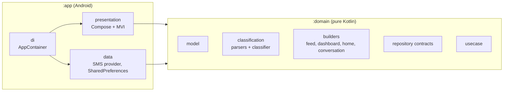
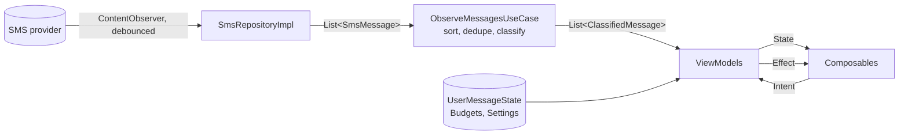

# Architecture

Two Gradle modules with a strict dependency direction.

`:domain` has no Android dependency, so the compiler enforces the rule and its tests run on any JVM.

## Data flow

## Presentation (MVI)

Each screen has a `Contract` (immutable `State`, `Intent`, one-shot `Effect`) and a `ViewModel` that reduces
intents into state. Composables are stateless (`State` in, `(Intent) -> Unit` out); the `*Route` composable
connects the ViewModel and handles effects (clipboard, links, permission).

Derived data (the feed, the dashboard, the home overview, conversations) is built by pure functions in
`:domain` (`FeedBuilder`, `DashboardBuilder`, ...) and stored in `State`, so recomposition does no heavy work.

## Classification

`MessageClassifier` runs rules in order (OTP, FASTag, money, data usage, courier, loyalty, generic). Money
messages go to the hand-written bank parsers first and then to `GenericTransactionParser`, a best-effort reader
for other banks' wording. It never throws and parses at most 4096 characters.

## Sheets and pages

Rule: **big content = a page, small content = a sheet.** A page is an `AppPage` (title, back arrow, content that scrolls,
optional pinned `footer`) drawn by `PageHost` over the screens and slid in from the side, like "Your year". A sheet is
`AppBottomSheet`, drawn by `SheetHost` over the pages, so a picker opened from a page appears above it, and the snackbar
(`LocalAppSnackbar`) is drawn above both. Compact pickers and confirmations (up to about five fields, simple choices)
stay sheets; long forms, detail views with many sections, lists of more than about eight rows, charts with lists and
multi-step flows are pages.

`AdaptiveSheet(title, onDismiss, asPage = false, autoPage = true, subtitle, footer, contentSpacing) { content }`
(`presentation/common/AdaptiveSheet.kt`) applies the rule in one place. `asPage = true` is a page from the first frame
(for content known to be large). Otherwise the sheet is first laid out invisibly (`AppBottomSheet(ready = false)`); if
header, content and footer together are taller than 85% of the window, the same content is shown as a page and the
sheet is never seen. The decision is made once and kept over rotation. State kept by the caller survives the switch; state
remembered inside the content lambda restarts. `FormSheet` is built on it (`asPage` too), so every form adapts. Content
that scrolls by itself (a lazy list or web view) uses `AppPage(scrollable = false)`. `SheetPolicyTest` keeps bare
`AppBottomSheet` to the compact allow-list and forbids fixed sheet heights.

## Guided tour

First launch and Settings, Help open a guided tour (`presentation/tour/`) that navigates the real app and spotlights real
elements through `Modifier.tourAnchor`. The content, progress and offer rules are pure and tested in `:domain`
(`domain/tour/`); see [TOUR.md](TOUR.md) for how to add a step or an anchor.

## Quick entry from outside the app

Three doors open the same hand-made entry flow: the "Quick add" home-screen widget (`QuickAddWidget`: two cash
presets that save at once with title "Cash spend", plus "Custom" and "Income" that open the sheet), the "Add entry"
quick-settings tile (`QuickAddTileService`, exported only because the system must bind it, guarded by
`BIND_QUICK_SETTINGS_TILE`), and sharing plain text to the app. The sheet is opened through `EntryRequests`: MainActivity
turns the incoming intent into an `EntryRequest` and Home takes it. Shared text is parsed once by the pure
`QuickEntryParser` (`:domain`) into amount, title and income/expense, then pre-fills `ManualEntrySheet`; the person
still confirms. Voice entry is the keyboard's own dictation into the sheet.

## Watch (Wear OS)

`WatchSnapshot` (`:domain`, `domain/wear`) is the pure, unit-tested description of what the watch shows, built from what
Home already worked out (`WatchSnapshots` in `:app`), with a stable flat string-map wire form (`toMap`/`fromMap`) and
`shouldPush` (send only on a change or after 30 minutes). Hidden amounts ("Hide amounts") are not sent at all. In `:app`,
`WearSync` is called from MainActivity while it is started (so on foreground, after a sync, and when settings change) and
hands snapshots to a `WatchLink`. The default build uses `NoWatchLink` (`src/wearOff`); `-PwithWear=true` swaps in
`src/wearOn` (`DataLayerWatchLink`, Wear Data Layer, adds `play-services-wearable`) and includes the `:wear` module
(Compose for Wear OS home screen, a tile and a complication, all reading the Data Layer copy; same application id as
the phone, `minSdk` 30). Without the flag the existing build, CI and `ManifestPolicyTest` are untouched; `WearPolicyTest`
keeps the normal build free of Play services and the watch manifest free of permissions.

## Budgets

A budget is a category's monthly amount, optionally with a daily cap. There is one concept, one store and one editor.
`BudgetRepository` (`:domain`) is the only store: prefs `budgets` (a key per category, plus an `adjustments` key holding
each category's carry-over choice, where carrying began and the money moved between budgets per cycle) and `daily_budgets`.
`SpendingLimits` (status of each budget today and this month, with carry-over and moves folded into the monthly limit) and
`Budgets` (carry-over, move money, "not yet assigned" from the plan's spendable) are pure and unit-tested. The editor is
Settings > Budgets (`LimitsSection`); Insights only shows status (`LimitsCard`) and links there.

The former Envelopes feature (prefs `envelopes`, per-cycle amounts) was merged into this. `BudgetRepositoryImpl` reads the
old file once, behind a `migrated_envelopes` flag in `budgets`: the latest cycle's amounts become monthly budgets where
none exist, and carry-over choices and moves are copied (`BudgetMigration`, pure and tested). The old file is left in
place. `PrefsBackup` copies every prefs file, so backups carry the unified store, and a backup made before the merge
restores and migrates on the next start. See `docs/UNIFICATION.md` for the other overlaps that were audited.

## Investments

A holding is something the person typed in from a receipt or statement: a fixed or recurring deposit, a mutual fund,
stocks, gold, bonds, PPF/NPS or anything else (`Holding`, `domain/investments`). EPF stays automatic (read from
passbook messages) and is added to the same totals as "Provident fund (from messages)".

* **Maths** (`InvestmentMath`, pure, tested). Fixed deposit: `P * (1 + r/n) ^ (n * t)`, `t` = tenure months / 12, else days / 365;
  simple interest `P * (1 + r*t)`; a maturity amount typed from the receipt (`maturityAmountGiven`) replaces the sum, and
  accrual between start and maturity then runs geometrically from principal to that amount. Recurring deposit: installment `M`
  at the start of each month `k = 1..N`, `sum M * (1 + r/n) ^ (n * (N-k+1) / 12)` (n = 4, the usual Indian bank formula).
  Accrued values never fall and never pass the maturity value. Funds, shares and gold: gain = current - invested, CAGR =
  `(current/invested) ^ (365.25/days) - 1` from 30 days. Everything is rounded to the rupee and labelled "Estimated".
* **Portfolio** (`Portfolio.summarize`): totals (deposits use the accrued estimate unless a value was entered), allocation,
  maturities, stale (older than 45 days) and missing values. Closed and renewed holdings are listed apart and never counted.
* **Store** (`HoldingStore`, atomic under one lock like `SetAsideStore`; `HoldingRepositoryImpl`, prefs `investments`, lazy
  in `AppContainer`): add, update, remove, update value (history capped at 60), mark matured, close, renew (a successor
  starting on the old maturity) and an exact per-holding `undo`.
* **Reminders**: `InvestmentReminders.build` derives `ManagedReminder`s (`inv:<holdingId>:mat|rd:<date>`, 9:00) from active
  deposits: configurable lead days and "on the day", plus an optional monthly RD installment reminder two days before.
  They are a second source for the existing `ReminderAlarms` (which keeps one inexact alarm for the next reminder with a
  time): `everything()` joins the person's reminders with the derived ones on every `schedule()`, so a changed, closed or
  deleted holding simply stops producing reminders and nothing stale needs cancelling. `MainActivity` re-schedules when
  holdings change, `BootReceiver` after a restart. The notification (channel `reminders_timed`, text through
  `NotificationPrivacy`) opens the Investments tab on that holding (`InvestmentRequests`). The same dates feed the
  calendar (`CalendarKind.MATURITY`) and Home's Plans card (`PlanKeys.maturity`, same Snooze/Dismiss, 14 days).
* **Net worth, no double counting**: `NetWorth.build` takes holdings (their current value, deposits estimated) and the ids
  of manual entries already migrated. `HoldingStore.migrate` copies old entries of the kinds fixed deposit, mutual funds,
  stocks, gold and retirement into holdings once (id `nw:<itemId>`, invested = current = the old amount) and records their ids in the
  same locked write, so an entry counts exactly once before and after. The originals stay in `net_worth`, hidden. The
  net-worth form no longer offers those kinds. Tested: totals match before and after.
* **UI**: `presentation/investments/` (hero, allocation bar, rows, detail page, form, value and close sheets). No network,
  no logo lookup (a drawn kind tile is used), receipts are a typed number only.

## Subscriptions and the salary strip

`Subscriptions.find` stays the one detector of repeating charges; it now also keeps the charge before the latest and the
first one of the run. `SubscriptionOverview.build` (`:domain`, pure, tested) lays them against the person's confirm/ignore
answers (`RecurringConfirmationRepository`) and cancelled marks (`CancelledSubscriptionRepository`, prefs
`cancelled_subscriptions`, key to epoch day, copied by `PrefsBackup`): yearly and monthly cost by `Cadence`, state
(Active/Paused/Cancelled; only Active is in the totals), a price-went-up flag above 3%, and modest question hints (new,
similar service from a small curated `ServiceKinds` list). `PaymentChannels.infer` reads the channel from the words of the
payment's own messages and `CancelGuides` gives the matching generic steps and the copy-able reference (name, amount,
cadence, last charge, last four digits; never message text). The page is `SubscriptionsPage` (Home's sheets, opened by
`OpenSubscriptions` from Bills, Insights or Search), built in `HomeViewModel` as one memoised part. The Google Play link is
a plain `ACTION_VIEW` handed to the phone (`openExternally`); the app makes no request of its own. A debit to a payee marked
cancelled, on a later day and of about the usual size, is found by `CancelledCharges` and raised in `ReviewQueue`
(`cancelledCharges`) and as a `HeadsUps` note. `RecurringPayments.arrange(..., cancelled)` drops cancelled ones from the
upcoming-payments lists.

`SalaryRunways.project` (`:domain`, pure, tested) projects the day the plan's spendable money runs out at this cycle's
pace, from `PlanInsights`; `SalaryStrip` draws it inside the Insights forecast card (or on its own without a forecast).

## Backup

Two optional places keep one encrypted copy of the person's setup, so it comes back after a reinstall or on a new phone. Both hold byte-for-byte the same file.

- **The file.** `BackupEngine` takes the preference snapshot (`PrefsBackup.capture`, which excludes messages' cache, logs, the developer and recent-search files, and the backup key and state files) and the chosen sender pictures, packs them with `BackupContainer` (a zip of `setup.json`, `meta.json` and `pictures/<base64url key>`; pictures over 20 MB together are skipped and the UI says so; old bare-JSON manual exports still open), and seals it with `BackupCrypto.encryptWith`. The envelope is the existing `zyke-backup` v1 JSON (salt and iteration count in the clear, AES-256-GCM), so the manual passphrase export and these files open through the same `BackupCrypto.open`.
- **The key.** At set-up the 6-digit PIN (or an advanced passphrase) is stretched once with PBKDF2-HMAC-SHA256 (600,000 rounds, random salt). `BackupKeyStore` keeps only the derived key, sealed by a non-exportable Android Keystore AES key, in `backup_secret` (never backed up). Scheduled backups therefore need no PIN; a new phone derives the same key again from the PIN and the salt in the file header, and keeps it for later backups.
- **A. Android Auto Backup.** `allowBackup=true`, but `backup_rules.xml` and `data_extraction_rules.xml` include only `files/auto_backup/zyke-backup.bin` (ManifestPolicyTest pins this). Android uploads it on its own schedule and restores it before first launch; `WelcomeBack` finds it and asks for the PIN. No network permission or sign-in involved.
- **B. Google Drive.** `DriveBackupClient` (the third network file) uses the Drive v3 REST API with a plain `HttpsURLConnection` against `appDataFolder` only; the access token comes from `DriveAuth`, implemented by `GmsDriveAuth` (Google Identity Authorization API, scope `drive.appdata`) and used nowhere else. The newest 7 files are kept (`DriveRetention`). Setting-up is in `docs/BACKUP_SETUP.md`.
- **C. A chosen folder.** `FolderBackupStore` writes `zyke-backup-yyyyMMdd-HHmmss.zbk` (`BackupFileNames`, `:domain`) into a tree picked once with `OpenDocumentTree`, using `DocumentsContract.createDocument` and `ContentResolver.openOutputStream` (no documentfile library). The grant is kept with `takePersistableUriPermission`; the address lives in `backup_folder`, excluded from `PrefsBackup` and Auto Backup. `FolderRetention` keeps the newest 7 matching names and never returns a foreign file for deletion. Its job has no network constraint. Losing the grant or the folder is reported as `FOLDER_LOST` ("Pick the folder again"), a full disk as `FOLDER_FULL`.
- **Schedule.** `BackupSchedule` (`:domain`, pure) answers `nextRun`/`nextAttempt` for daily, weekly, fortnightly and monthly in the phone's zone, with daylight-saving handling and catch-up of missed runs. `BackupScheduler` queues one persisted `JobScheduler` job per place with the Wi-Fi and charging constraints; `BackupJobService` runs `BackupRunner` and queues the next. WorkManager is not a dependency of the app, so JobScheduler is used. The Auto Backup file is also refreshed when the app is opened and its time has passed.
- **Restore from a file.** One entry in Settings and in `WelcomeBack`: `OpenDocument` (`*/*`), `BackupRestorer.readChosenFile` (50 MB cap, `BackupFileCheck` looks at the first bytes for the `zyke-backup` header before the PIN is asked), then `RestoreFlow(FILE)`, the same flow as the phone and Drive sources. The old separate manual "Import" path is gone.
- **First launch.** `FirstRunDecision` (`:domain`, tested) decides from the facts `FirstRun` gathers; every step runs through `FirstRun.step` (logged under tag `firstrun` in the developer log and black box, never fatal). Welcome stops being offered after 3 unanswered shows, and a crash while it is on screen marks it done.
- **Restore.** `BackupRestorer` opens a file (a wrong PIN waits one second), `PrefsBackup.apply` replaces the setup, `ImageStore.restoreChosenPictures` the pictures; the app then closes so nothing in memory writes the old values back, as with the manual import. A restore asks first if a setup already exists.
- **Log.** Every run writes one `DevLog` line under `backup` (trigger, place, result, size, duration, failure class); never the PIN, key, token, account, contents, amounts or names.

## Logs and "Share logs"

Two records live in `files/dev_logs/`. `DevLog` is the verbose developer log (developer mode only). `BlackBox` is a small
always-on record (`blackbox.log`, rotated at about 256 KB, one earlier file kept): `ZykeMessagesApplication.onCreate`
installs it before anything else, so its crash handler (class names, function names and line numbers; never the exception
message) and its start-up and screen markers exist even when the container or a store fails. `AppContainer` is built lazily
for the same reason, so a failure there ends the screen that asked rather than the whole process. Earlier exits from
`ApplicationExitInfo` are added once each. Writes are synchronous, small and wrapped so they cannot throw.

"Share logs" has three doors (the launcher icon's long-press shortcut (next to "Demo mode", see below), Settings, About, and Developer options) and one
implementation: `LogShare` reads the files, `LogBundle` (`:domain`, pure, tested) builds the header and keeps the newest
content under 1.5 MB, and the result goes through the `shared_logs/` cache folder of the FileProvider and `ACTION_SEND`
(text/plain). The shortcut (`res/xml/shortcuts.xml`) targets `ShareLogsActivity`, a screen-less, non-exported plain
`Activity` that touches no container, store, view model or Compose; `ManifestPolicyTest` and `BlackBoxPolicyTest` pin this.

## Demo mode

For showing the app to someone else without showing the person's own money. Entered from the launcher icon's long-press
shortcut ("Demo mode", `DemoActivity`, same plain screen-less shape as "Share logs") or from Settings, Demo mode. The whole
app then runs on a made-up person ("Asha Menon"), and nothing real is read, shown, written or announced.

* **Data.** `DemoData.build(now, zone)` (`:domain/demo`, pure, deterministic, tested) writes six months of SMS bodies in real
  banks' wording, dated back from `now` so it always looks current, plus the setup (cards, plan, budgets, goals, deposits, loan,
  reminders, events, names, categories, a market strip with fixed prices). The bodies go through the real `MessageClassifier` and
  the real pipeline, so every card, the card-bill matching (a bill paid from the account is not spending twice), recurring
  payments and the SIP series are computed by the app, not painted. `DemoDataTest` pins this.
* **Isolation by construction.** The switch is one boolean in its own preference file, `demo_mode`, read first thing in
  `Application.onCreate`; the process is restarted to change it (`RestartActivity`, in its own `:restart` process), so a process
  is wholly real or wholly demo. In a demo process `AppContainer(DemoContext(app), demo = true)` is built: `DemoContext` is a
  `ContextWrapper` whose preference files are in-memory (`MemoryPrefs`), whose private folders are a scratch folder under the
  cache that is emptied at the start and end, and whose `applicationContext` is itself, so every `XxxRepositoryImpl(context)`
  is the app's ordinary store but cannot reach the real files; there is no path back to them. The inbox is `DemoSmsRepository`
  (a fixed list; no provider, no SMS permission), the classification cache is `NoClassificationCache`, `ImageStore` is offline,
  `MarketTicker` answers from fixed prices (no request for prices, search or charts) and `DemoSeeder` loads the setup into the
  in-memory stores. Writes made in the demo go to memory and vanish with the process. `DemoPolicyTest` reads the sources and
  keeps these doors shut.
* **Nothing in the background.** In a demo process `canNotify` is false and receivers, schedulers, the reminder alarm, the
  widget, the chat-notification reader, boot handling, backups (engine, runner, scheduler, job, `PrefsBackup.capture/apply`) and
  `DataWipe` all refuse; the launcher-icon colour and the live-alert component are left alone. Entering clears the app's
  notifications; real alarms are only cancelled, and the real app sets them again on its next start.
* **Lock and persistence.** Entering needs no unlock because nothing real is shown; leaving restarts the real app, which asks
  for the app lock exactly as on any cold start. The switch survives the process being killed in the background (so coming back
  to a demonstration never shows the real data) and is cleared only by "Exit demo mode". `demo_mode` is in `PrefsBackup`'s
  exclusion list and is never in Auto Backup, so a backup can neither carry it nor restore it.
* **UI.** A slim line under the toolbar on every tab ("Demo mode · sample data, not yours" and Exit, which asks first). No SMS,
  notification or notification-access prompts; the tour is not offered on the way in (it is under Settings, Help); photos and web
  picture search, app-icon colours, backup and "Delete all my data" are not offered in the demo.

## Share codes with trusted people

For a login code the user shares with family: when a code for an allowed streaming service arrives on the phone, the app sends it
on by SMS to the people the user chose, so they can sign in while the user is asleep or busy. Off by default in every part (master
switch, people, hours, pause); Settings, Reminders and alerts, Share codes with trusted people.

* **Rules (`:domain/sharing`, pure, tested in `CodeSharingTest`).** `CodeSharing.decide(message, rules, now, history, zone)`
  returns the texts to send (`Share`: person, service, text) or the reasons it did not (`ShareSkip`). Hard blocks come first and
  no setting overrides them: anything financial (a `Transaction`, `CardBill`, `ScheduledPayment`, anything `Counting.of` counts,
  an OTP with a payment amount or card, any bank / UPI / card / wallet / payment / amount / "Rs", "INR", rupee-sign / transaction
  wording, or a bank or payment-app sender header), government, insurer and phone-company account security (Aadhaar, tax,
  insurance, SIM, porting ...), and any sender header that is not one of the allowed services' own. A code needs both an OTP
  classification (digits, 4 to 8) and a service match. `ShareServices` lists exactly six services (Netflix, Hotstar incl. Disney+
  and JioHotstar, Prime Video, Sun NXT, Sony LIV, ZEE5); to add one, add a `ShareService` and a test. The SENDER header must match
  (operator route letters stripped, so `VM-NFLXIN-S` is `NFLXIN`); the body only confirms. A body naming another service is
  ambiguous and not sent. Amazon's header also sends shopping and Amazon Pay codes, so it needs "Prime" in the body. Wording
  alone from an unknown header is never enough. "Do not share" is in every OTP, so it is not a block by itself; it blocks only
  together with payment or transaction wording (which blocks on its own).
* **What is sent.** Only the code and the service name: `Netflix code 482913 (use it soon). Sent by Aman via Zyke`, plain ASCII,
  one SMS segment (the name is reduced to letters, digits and a few marks, 20 characters; blank is just `Sent by Zyke`). Never
  the original message. Limits: at most 5 an hour to one person (`maxPerHour`), the same code + service + person is never sent
  twice, a message older than 5 minutes (or dated in the future) is never sent, an optional daily window (overnight such as
  22:00 to 08:00 handled), a quick pause ("Off for 1, 8, 24 hours"), a per-person switch and a per-person set of services.
* **Live path only.** `SmsReceiver` calls `CodeSharer.onLiveMessage` after classification, for the message that has just arrived;
  nothing else calls it (`CodeSharingPolicyTest` pins that), so reading the inbox never forwards anything. Freshness in the rules
  is a second line of defence. The receiver now runs when either the code alerts or sharing is on (`LiveAlerts.refreshReceiver`
  keeps the component setting in step, also at start and after a restore); the two features are independent, and reading paused
  stops both. Work is on a background coroutine under `goAsync`, with no network.
* **Sending (`CodeSharer`, `:app`).** `SmsManager` (the default SMS subscription on a dual-SIM phone), divided into parts only if
  a text were ever longer than one segment, every call caught. Sent and delivered `PendingIntent`s go to the non-exported
  `CodeShareStatusReceiver`, which moves the log entry Sending, Sent, Delivered or Failed (`ShareLog.advance`: never backwards)
  and posts a low-importance note, "Sent Netflix code to Sister" or "Couldn't send to Sister" (no code; private on the lock
  screen). "Test message" sends `Test from Zyke: code sharing is set up` after a confirm dialog naming the person and the text,
  not twice within a minute.
* **Permissions.** `SEND_SMS` is in the manifest but asked for only when the master switch is turned on (together with
  `RECEIVE_SMS`, and `POST_NOTIFICATIONS` on Android 13+); `CodeSharingHealth` (next to `CodeAlertHealth`) says what is in the
  way and the page offers the one tap that fixes it. Google Play restricts SMS permissions to default SMS apps, so this feature
  is for builds installed directly (sideloaded); a Play build would have to leave `SEND_SMS` and `CodeSharer` out. The
  "nothing leaves your phone" promise is kept in the sense that the only thing sent is what the user chose to send, by SMS and
  not over the network; `ManifestPolicyTest` lists the permission and the status receiver and still forbids new network code.
* **People.** Name and normalised number only (`PhoneNumbers.normalise`: Indian 10-digit with 0 / 91 / +91, or international `+`
  and 8 to 15 digits). The contact picker is the system's (`ACTION_PICK` on phone numbers), which hands over only the row
  picked, so `READ_CONTACTS` is never requested; a number can also be typed.
* **Privacy and logging.** A code, a number or a message body is never written to the developer log, `BlackBox`, the saved log or
  a notification. The saved log (`code_sharing_log`, left out of backups) has service, person's name, time and status. The
  duplicate check's code keys live in memory only. The people and settings are in the `code_sharing` preferences file and are
  carried by `PrefsBackup` (PIN-encrypted) like every other setup file.
* **Demo mode.** `AppContainer` uses `NoCodeSharing` in a demo process; the receiver, `CodeSharer` and the status receiver stop on
  `DemoMode.active` (`DemoPolicyTest`), the page shows only "Not available in Demo mode", and the contact picker and permission
  prompts are not reachable.

## Budget phones and lite mode

`presentation/common/Responsive.kt` (`LocalResponsive`, `ChromeScale`, `FitText`, `ResponsiveRow`) holds the layout rules for
narrow screens and large text, `LocalLite` the lite-mode switch; the decisions themselves (`LiteMode.resolve`, `LowEndRules`,
`ScreenClass`, `DeviceProfile`) are pure and tested in `:domain`. `data/perf/LowEnd.kt` reads the phone's memory; `LiteRuntime`
bounds the derive pipelines in lite mode. See [LOWEND.md](LOWEND.md).

## Quality gates

`:domain:test`, `:app:testDebugUnitTest`, `detekt` (zero issues), Android lint, and `ManifestPolicyTest`
(privacy promise). CI runs them on every pull request.

## Launcher icon colour

Android cannot recolour a launcher icon at run time, so the choice is a fixed palette of `<activity-alias>` entries
(`.IconDefault`, `.IconBlue` ... `.IconMono`), all targeting `MainActivity`, which itself has no launcher filter. Each
alias has its own adaptive icon (`mipmap-anydpi-v26/ic_launcher_<id>.xml`: a coloured background vector, the shared
`zyke_icon` foreground and monochrome layer) and carries the `android.app.shortcuts` meta-data so the "Share logs"
shortcut works whichever is enabled. Only `.IconDefault` is enabled in the manifest. `AppIconChoice` (domain) lists the
variants; `AppIconSwitcher` enables the new alias before disabling the others (never zero enabled) with
`DONT_KILL_APP`, off the main thread, and `MainActivity.onCreate` reconciles the saved choice with the enabled alias
(after a restore). Settings, Appearance, App icon shows the palette and asks before switching, since launchers differ
(a few seconds' delay, the app closing, or the icon moving). Custom colours are not possible for the icon.
`ManifestPolicyTest` keeps the manifest and the enum in step.
