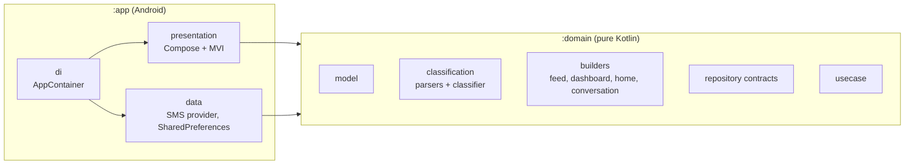
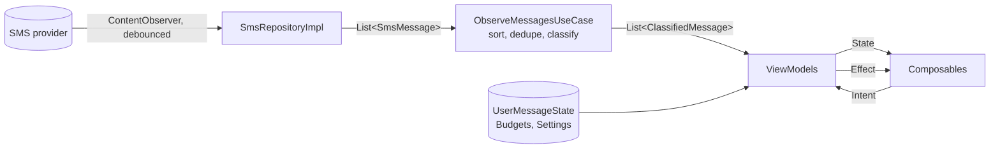

# Architecture

Two Gradle modules with a strict dependency direction.

`:domain` has no Android dependency, so the compiler enforces the rule and its tests run on any JVM.

## Data flow

## Presentation (MVI)

Each screen has a `Contract` (immutable `State`, `Intent`, one-shot `Effect`) and a `ViewModel` that reduces
intents into state. Composables are stateless (`State` in, `(Intent) -> Unit` out); the `*Route` composable
connects the ViewModel and handles effects (clipboard, links, permission).

Derived data (the feed, the dashboard, the home overview, conversations) is built by pure functions in
`:domain` (`FeedBuilder`, `DashboardBuilder`, ...) and stored in `State`, so recomposition does no heavy work.

## Classification

`MessageClassifier` runs rules in order (OTP, FASTag, money, data usage, courier, loyalty, generic). Money
messages go to the hand-written bank parsers first and then to `GenericTransactionParser`, a best-effort reader
for other banks' wording. It never throws and parses at most 4096 characters.

## Sheets and pages

Rule: **big content = a page, small content = a sheet.** A page is an `AppPage` (title, back arrow, content that scrolls,
optional pinned `footer`) drawn by `PageHost` over the screens and slid in from the side, like "Your year". A sheet is
`AppBottomSheet`, drawn by `SheetHost` over the pages, so a picker opened from a page appears above it, and the snackbar
(`LocalAppSnackbar`) is drawn above both. Compact pickers and confirmations (up to about five fields, simple choices)
stay sheets; long forms, detail views with many sections, lists of more than about eight rows, charts with lists and
multi-step flows are pages.

`AdaptiveSheet(title, onDismiss, asPage = false, autoPage = true, subtitle, footer, contentSpacing) { content }`
(`presentation/common/AdaptiveSheet.kt`) applies the rule in one place. `asPage = true` is a page from the first frame
(for content known to be large). Otherwise the sheet is first laid out invisibly (`AppBottomSheet(ready = false)`); if
header, content and footer together are taller than 85% of the window, the same content is shown as a page and the
sheet is never seen. The decision is made once and kept over rotation. State kept by the caller survives the switch; state
remembered inside the content lambda restarts. `FormSheet` is built on it (`asPage` too), so every form adapts. Content
that scrolls by itself (a lazy list or web view) uses `AppPage(scrollable = false)`. `SheetPolicyTest` keeps bare
`AppBottomSheet` to the compact allow-list and forbids fixed sheet heights.

## Quick entry from outside the app

Three doors open the same hand-made entry flow: the "Quick add" home-screen widget (`QuickAddWidget`: two cash
presets that save at once with title "Cash spend", plus "Custom" and "Income" that open the sheet), the "Add entry"
quick-settings tile (`QuickAddTileService`, exported only because the system must bind it, guarded by
`BIND_QUICK_SETTINGS_TILE`), and sharing plain text to the app. The sheet is opened through `EntryRequests`: MainActivity
turns the incoming intent into an `EntryRequest` and Home takes it. Shared text is parsed once by the pure
`QuickEntryParser` (`:domain`) into amount, title and income/expense, then pre-fills `ManualEntrySheet`; the person
still confirms. Voice entry is the keyboard's own dictation into the sheet.

## Watch (Wear OS)

`WatchSnapshot` (`:domain`, `domain/wear`) is the pure, unit-tested description of what the watch shows, built from what
Home already worked out (`WatchSnapshots` in `:app`), with a stable flat string-map wire form (`toMap`/`fromMap`) and
`shouldPush` (send only on a change or after 30 minutes). Hidden amounts ("Hide amounts") are not sent at all. In `:app`,
`WearSync` is called from MainActivity while it is started (so on foreground, after a sync, and when settings change) and
hands snapshots to a `WatchLink`. The default build uses `NoWatchLink` (`src/wearOff`); `-PwithWear=true` swaps in
`src/wearOn` (`DataLayerWatchLink`, Wear Data Layer, adds `play-services-wearable`) and includes the `:wear` module
(Compose for Wear OS home screen, a tile and a complication, all reading the Data Layer copy; same application id as
the phone, `minSdk` 30). Without the flag the existing build, CI and `ManifestPolicyTest` are untouched; `WearPolicyTest`
keeps the normal build free of Play services and the watch manifest free of permissions.

## Budgets

A budget is a category's monthly amount, optionally with a daily cap. There is one concept, one store and one editor.
`BudgetRepository` (`:domain`) is the only store: prefs `budgets` (a key per category, plus an `adjustments` key holding
each category's carry-over choice, where carrying began and the money moved between budgets per cycle) and `daily_budgets`.
`SpendingLimits` (status of each budget today and this month, with carry-over and moves folded into the monthly limit) and
`Budgets` (carry-over, move money, "not yet assigned" from the plan's spendable) are pure and unit-tested. The editor is
Settings > Budgets (`LimitsSection`); Insights only shows status (`LimitsCard`) and links there.

The former Envelopes feature (prefs `envelopes`, per-cycle amounts) was merged into this. `BudgetRepositoryImpl` reads the
old file once, behind a `migrated_envelopes` flag in `budgets`: the latest cycle's amounts become monthly budgets where
none exist, and carry-over choices and moves are copied (`BudgetMigration`, pure and tested). The old file is left in
place. `PrefsBackup` copies every prefs file, so backups carry the unified store, and a backup made before the merge
restores and migrates on the next start. See `docs/UNIFICATION.md` for the other overlaps that were audited.

## Subscriptions and the salary strip

`Subscriptions.find` stays the one detector of repeating charges; it now also keeps the charge before the latest and the
first one of the run. `SubscriptionOverview.build` (`:domain`, pure, tested) lays them against the person's confirm/ignore
answers (`RecurringConfirmationRepository`) and cancelled marks (`CancelledSubscriptionRepository`, prefs
`cancelled_subscriptions`, key to epoch day, copied by `PrefsBackup`): yearly and monthly cost by `Cadence`, state
(Active/Paused/Cancelled; only Active is in the totals), a price-went-up flag above 3%, and modest question hints (new,
similar service from a small curated `ServiceKinds` list). `PaymentChannels.infer` reads the channel from the words of the
payment's own messages and `CancelGuides` gives the matching generic steps and the copy-able reference (name, amount,
cadence, last charge, last four digits; never message text). The page is `SubscriptionsPage` (Home's sheets, opened by
`OpenSubscriptions` from Bills, Insights or Search), built in `HomeViewModel` as one memoised part. The Google Play link is
a plain `ACTION_VIEW` handed to the phone (`openExternally`); the app makes no request of its own. A debit to a payee marked
cancelled, on a later day and of about the usual size, is found by `CancelledCharges` and raised in `ReviewQueue`
(`cancelledCharges`) and as a `HeadsUps` note. `RecurringPayments.arrange(..., cancelled)` drops cancelled ones from the
upcoming-payments lists.

`SalaryRunways.project` (`:domain`, pure, tested) projects the day the plan's spendable money runs out at this cycle's
pace, from `PlanInsights`; `SalaryStrip` draws it inside the Insights forecast card (or on its own without a forecast).

## Backup

Two optional places keep one encrypted copy of the person's setup, so it comes back after a reinstall or on a new phone. Both hold byte-for-byte the same file.

- **The file.** `BackupEngine` takes the preference snapshot (`PrefsBackup.capture`, which excludes messages' cache, logs, the developer and recent-search files, and the backup key and state files) and the chosen sender pictures, packs them with `BackupContainer` (a zip of `setup.json`, `meta.json` and `pictures/<base64url key>`; pictures over 20 MB together are skipped and the UI says so; old bare-JSON manual exports still open), and seals it with `BackupCrypto.encryptWith`. The envelope is the existing `zyke-backup` v1 JSON (salt and iteration count in the clear, AES-256-GCM), so the manual passphrase export and these files open through the same `BackupCrypto.open`.
- **The key.** At set-up the 6-digit PIN (or an advanced passphrase) is stretched once with PBKDF2-HMAC-SHA256 (600,000 rounds, random salt). `BackupKeyStore` keeps only the derived key, sealed by a non-exportable Android Keystore AES key, in `backup_secret` (never backed up). Scheduled backups therefore need no PIN; a new phone derives the same key again from the PIN and the salt in the file header, and keeps it for later backups.
- **A. Android Auto Backup.** `allowBackup=true`, but `backup_rules.xml` and `data_extraction_rules.xml` include only `files/auto_backup/zyke-backup.bin` (ManifestPolicyTest pins this). Android uploads it on its own schedule and restores it before first launch; `WelcomeBack` finds it and asks for the PIN. No network permission or sign-in involved.
- **B. Google Drive.** `DriveBackupClient` (the third network file) uses the Drive v3 REST API with a plain `HttpsURLConnection` against `appDataFolder` only; the access token comes from `DriveAuth`, implemented by `GmsDriveAuth` (Google Identity Authorization API, scope `drive.appdata`) and used nowhere else. The newest 7 files are kept (`DriveRetention`). Setting-up is in `docs/BACKUP_SETUP.md`.
- **C. A chosen folder.** `FolderBackupStore` writes `zyke-backup-yyyyMMdd-HHmmss.zbk` (`BackupFileNames`, `:domain`) into a tree picked once with `OpenDocumentTree`, using `DocumentsContract.createDocument` and `ContentResolver.openOutputStream` (no documentfile library). The grant is kept with `takePersistableUriPermission`; the address lives in `backup_folder`, excluded from `PrefsBackup` and Auto Backup. `FolderRetention` keeps the newest 7 matching names and never returns a foreign file for deletion. Its job has no network constraint. Losing the grant or the folder is reported as `FOLDER_LOST` ("Pick the folder again"), a full disk as `FOLDER_FULL`.
- **Schedule.** `BackupSchedule` (`:domain`, pure) answers `nextRun`/`nextAttempt` for daily, weekly, fortnightly and monthly in the phone's zone, with daylight-saving handling and catch-up of missed runs. `BackupScheduler` queues one persisted `JobScheduler` job per place with the Wi-Fi and charging constraints; `BackupJobService` runs `BackupRunner` and queues the next. WorkManager is not a dependency of the app, so JobScheduler is used. The Auto Backup file is also refreshed when the app is opened and its time has passed.
- **Restore from a file.** One entry in Settings and in `WelcomeBack`: `OpenDocument` (`*/*`), `BackupRestorer.readChosenFile` (50 MB cap, `BackupFileCheck` looks at the first bytes for the `zyke-backup` header before the PIN is asked), then `RestoreFlow(FILE)`, the same flow as the phone and Drive sources. The old separate manual "Import" path is gone.
- **First launch.** `FirstRunDecision` (`:domain`, tested) decides from the facts `FirstRun` gathers; every step runs through `FirstRun.step` (logged under tag `firstrun` in the developer log and black box, never fatal). Welcome stops being offered after 3 unanswered shows, and a crash while it is on screen marks it done.
- **Restore.** `BackupRestorer` opens a file (a wrong PIN waits one second), `PrefsBackup.apply` replaces the setup, `ImageStore.restoreChosenPictures` the pictures; the app then closes so nothing in memory writes the old values back, as with the manual import. A restore asks first if a setup already exists.
- **Log.** Every run writes one `DevLog` line under `backup` (trigger, place, result, size, duration, failure class); never the PIN, key, token, account, contents, amounts or names.

## Logs and "Share logs"

Two records live in `files/dev_logs/`. `DevLog` is the verbose developer log (developer mode only). `BlackBox` is a small
always-on record (`blackbox.log`, rotated at about 256 KB, one earlier file kept): `ZykeMessagesApplication.onCreate`
installs it before anything else, so its crash handler (class names, function names and line numbers; never the exception
message) and its start-up and screen markers exist even when the container or a store fails. `AppContainer` is built lazily
for the same reason, so a failure there ends the screen that asked rather than the whole process. Earlier exits from
`ApplicationExitInfo` are added once each. Writes are synchronous, small and wrapped so they cannot throw.

"Share logs" has three doors (the launcher icon's long-press shortcut, Settings, About, and Developer options) and one
implementation: `LogShare` reads the files, `LogBundle` (`:domain`, pure, tested) builds the header and keeps the newest
content under 1.5 MB, and the result goes through the `shared_logs/` cache folder of the FileProvider and `ACTION_SEND`
(text/plain). The shortcut (`res/xml/shortcuts.xml`) targets `ShareLogsActivity`, a screen-less, non-exported plain
`Activity` that touches no container, store, view model or Compose; `ManifestPolicyTest` and `BlackBoxPolicyTest` pin this.

## Quality gates

`:domain:test`, `:app:testDebugUnitTest`, `detekt` (zero issues), Android lint, and `ManifestPolicyTest`
(privacy promise). CI runs them on every pull request.

## Launcher icon colour

Android cannot recolour a launcher icon at run time, so the choice is a fixed palette of `<activity-alias>` entries
(`.IconDefault`, `.IconBlue` ... `.IconMono`), all targeting `MainActivity`, which itself has no launcher filter. Each
alias has its own adaptive icon (`mipmap-anydpi-v26/ic_launcher_<id>.xml`: a coloured background vector, the shared
`zyke_icon` foreground and monochrome layer) and carries the `android.app.shortcuts` meta-data so the "Share logs"
shortcut works whichever is enabled. Only `.IconDefault` is enabled in the manifest. `AppIconChoice` (domain) lists the
variants; `AppIconSwitcher` enables the new alias before disabling the others (never zero enabled) with
`DONT_KILL_APP`, off the main thread, and `MainActivity.onCreate` reconciles the saved choice with the enabled alias
(after a restore). Settings, Appearance, App icon shows the palette and asks before switching, since launchers differ
(a few seconds' delay, the app closing, or the icon moving). Custom colours are not possible for the icon.
`ManifestPolicyTest` keeps the manifest and the enum in step.
