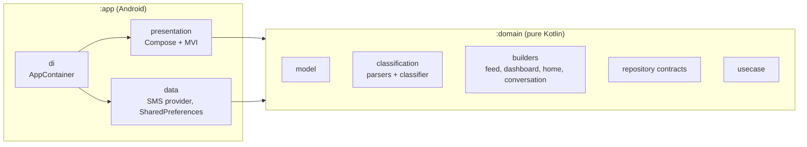
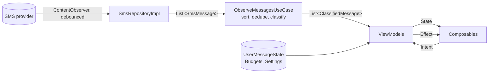

# Architecture

Two Gradle modules with a strict dependency direction.

`:domain` has no Android dependency, so the compiler enforces the rule and its tests run on any JVM.

## Data flow

## Presentation (MVI)

Each screen has a `Contract` (immutable `State`, `Intent`, one-shot `Effect`) and a `ViewModel` that reduces
intents into state. Composables are stateless (`State` in, `(Intent) -> Unit` out); the `*Route` composable
connects the ViewModel and handles effects (clipboard, links, permission).

Derived data (the feed, the dashboard, the home overview, conversations) is built by pure functions in
`:domain` (`FeedBuilder`, `DashboardBuilder`, ...) and stored in `State`, so recomposition does no heavy work.

## Classification

`MessageClassifier` runs rules in order (OTP, FASTag, money, data usage, courier, loyalty, generic). Money
messages go to the hand-written bank parsers first and then to `GenericTransactionParser`, a best-effort reader
for other banks' wording. It never throws and parses at most 4096 characters.

## Quality gates

`:domain:test`, `:app:testDebugUnitTest`, `detekt` (zero issues), Android lint, and `ManifestPolicyTest`
(privacy promise). CI runs them on every pull request.
